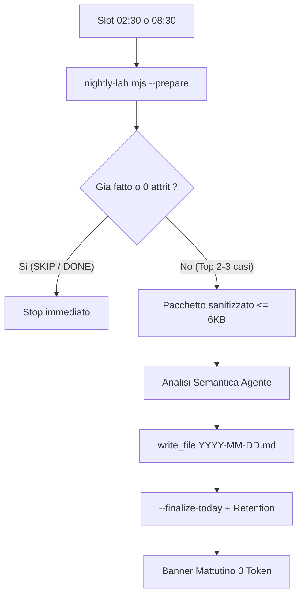

# Piano Esecutivo (v2 Post-Audit): Laboratorio Metodologico (`interaction-lab` in `plugins/mapek` v1.2.0)

> **Istruzione per l'Agente (Sessione Locale o Cloud)**: esegui questo piano sequenzialmente dalla **Fase A** alla **Fase E**. Usa esclusivamente percorsi relativi al repository o `~` (zero percorsi assoluti di macchina come `C:/Users/...`, `D:/Github/...` o `/home/...`).

---

## 1. Obiettivo e Confini di Sicurezza

Realizzare un flusso automatico giornaliero (e invocabile su richiesta con `/interaction-lab`) che analizzi sul piano semantico le sessioni di lavoro reali per **affinare il metodo di interazione Umano-Agente** e misurare sul campo pratiche d'uso di Google Antigravity, senza duplicare i sensori sintattici già attivi a fine turno.

> [!IMPORTANT]
> **Vincoli Invarianti Verificati nell'Audit**:
> 1. **Sola lettura sui progetti e zero modifiche non approvate**: il job automatico legge solo `brain/` e `analytics/`, scrive unicamente report in `~/.gemini/antigravity/analytics/nightly-reports/` e aggiorna il proprio cursore locale. Non modifica mai codice sorgente, `MEMORY.md` o plugin senza approvazione umana al mattino.
> 2. **Zero byte aggiunti alle regole inline (`rules/AGENTS.md`)**: l'intera funzionalità vive in `plugins/mapek` (`v1.1.0` -> `v1.2.0`) tramite moduli headless, pre-hook esistente e skill on-demand, lasciando invariato il budget aggregato di `48 KB` controllato da [`scripts/validate.mjs`](../../scripts/validate.mjs).
> 3. **Immunità da stalli notturni (`0` `ask_question`, `0` comandi fuori lista)**: il flusso schedulato non può mai aprire domande interattive né invocare script non presenti nei permessi pre-autorizzati.

---

## 2. Architettura a Due Stadi e Doppio Slot Idempotente (`02:30` + `08:30`)

Per coprire sia le notti a PC acceso sia le notti a PC spento o in sospensione (`23:08 -> 07:10`), la schedulazione usa un **doppio appuntamento giornaliero (`30 2,8 * * *` `Europe/Rome`)** protetto da guardia idempotente `ALREADY_DONE_TODAY` (`< 50ms`, `0` report duplicati).

---

## 3. Moduli e Modifiche Puntuali (Recepimento dei 7 Rilievi Audit)

### Fase A — Isolamento Totale delle Conversazioni Non Presidiate (Rilievi Audit `#1` e `#5`)
Ogni sessione avviata dallo scheduler inizia con il marcatore canonico `[AUTOMATION-RUN: nightly-interaction-lab]`:
1. **Uscita Immediata Pre-Hook anti-stallo**:
   - In [`plugins/adaptive-router/scripts/router-pre-hook.mjs`](../../plugins/adaptive-router/scripts/router-pre-hook.mjs): uscire subito con `{}\n` in testa a `main()` quando `lastUserInput` (o la testa del transcript) contiene `[AUTOMATION-RUN:`, impedendo qualsiasi iniezione `UNDERPROVISIONED_UI_MODEL` o `CALIBRATE_MODEL_ROSTER_ONCE` (che chiederebbe `ask_question` o `swarm` di notte).
   - In [`plugins/mapek/scripts/mapek-pre-hook.mjs`](../../plugins/mapek/scripts/mapek-pre-hook.mjs) e [`plugins/human-governor/scripts/governor-hook.mjs`](../../plugins/human-governor/scripts/governor-hook.mjs): `isSubagentTranscriptHead` riconosce `[AUTOMATION-RUN:` come esecuzione automatica non-umana, evitando falsi allarmi sul coprifuoco `22:30-07:00` e sul limite di sessioni parallele (`WIP`).
2. **Esclusione Unificata da Statistiche e Mining**:
   - Allineare il predicato condiviso anche in [`plugins/proactive-mentorship/scripts/session-miner.mjs`](../../plugins/proactive-mentorship/scripts/session-miner.mjs), [`plugins/mapek/core/trajectory-analyzer.mjs`](../../plugins/mapek/core/trajectory-analyzer.mjs), [`plugins/telemetry-analytics/core/session-backfill.mjs`](../../plugins/telemetry-analytics/core/session-backfill.mjs), [`plugins/telemetry-analytics/scripts/collector.mjs`](../../plugins/telemetry-analytics/scripts/collector.mjs) e `periodic-harvester-hook.mjs` (`pattern-harvester`), così le esecuzioni schedulate non vengono mai conteggiate come sessioni umane in `/plugin-analytics` né rianalizzate la notte seguente.

### Fase B — Stadio 1: Distillatore Deterministico e Sanitizzazione (Rilievi Audit `#4` e `#6`)
1. **`plugins/mapek/core/nightly-packet-builder.mjs` (Headless Core, 100% Node.js)**:
   - Legge il cursore `nightly-lab-state.json` (`lastCompletedDate`, `lastAnalyzedMs`). Se `lastCompletedDate === todayLocal`, restituisce subito `{ status: "ALREADY_DONE_TODAY" }`.
   - Scansiona le conversazioni umane modificate dopo `lastAnalyzedMs` (coprendo anche più giorni se il PC è rimasto spento nel weekend) su `~/.gemini/antigravity/brain` e `~/.gemini/jetski/brain`.
   - **Gate `SKIP_CLEAN`**: se ci sono `0` sessioni umane nuove o nessuna sessione presenta segnali di attrito (nessuna riformulazione ravvicinata dell'utente, nessun cambio di rotta post-codice, picco contesto `<= 20%` e nessun esperimento attivo giunto a scadenza), aggiorna `lastCompletedDate` e restituisce `{ status: "SKIP_CLEAN" }`.
   - **Estrazione Scheletrica Sanitizzata (`<= 6 KB`)**: seleziona al massimo le **2-3 sessioni con peggior rapporto risultato/passaggi**, estraendo solo i prompt utente, le menzioni `@file` / `/slash`, i cambi modello, la sequenza compatta RLE delle azioni agente ([`plugins/pattern-harvester/core/harvester-engine.mjs`](../../plugins/pattern-harvester/core/harvester-engine.mjs)), i turni di svolta (*pivot turns*) e i delta token/tempo. Prima dell'emissione rimuove tag di sistema (`<system>`, `[AUTOMATION-RUN:`, finti header direttivi) eventualmente presenti in log esterni incollati dall'utente in chat.

### Fase C — Unificazione Esperimenti su `mastery-ledger.mjs` (Rilievo Audit `#3`)
1. **Estensione SSOT in [`plugins/mapek/core/mastery-ledger.mjs`](../../plugins/mapek/core/mastery-ledger.mjs) (Zero Cataloghi Duplicati `M1..M4`)**:
   - Nessun file separato `methodology-experiments.json` e nessun elenco fisso cablato (in conformità a [`plugins/skill-governance/rules/AGENTS.md`](../../plugins/skill-governance/rules/AGENTS.md)).
   - Aggiungere al profilo esistente `operator-mastery.json` il campo opzionale `activeExperiment` (1 solo esperimento attivo per volta su una finestra di `5` sessioni umane idonee), agganciabile:
     - a una delle **5 dimensioni `MASTERY_DIMENSIONS` già esistenti** (`specClarity`, `deterministicDebugging`, `contextHygiene`, `delegationLeverage`, `verificationDiscipline`), automatica sulla dimensione con punteggio EMA più basso, **oppure**
     - a un'ipotesi metodologica aperta (`customHypothesis`, definita dall'utente o proposta dal report mattutino, es. uso di `/grill-me`, `/handoff`, `run_workflow`).
   - Funzione pura `evaluateExperimentWindow(activeExperiment, analyzedSessions)` che calcola il confronto oggettivo **Baseline pre-prova vs Finestra delle 5 sessioni** su: punteggio dimensione target, turni medi per task, tasso di riformulazione utente e picco medio contesto `%`, archiviando l'esito (`ADOTTA`, `RAFFINA`, `SCARTA`) nello storico esistente `process-ledger.json`.

### Fase D — CLI Windows-Safe, Skill On-Demand e Pre-Hook Unificato (Rilievi Audit `#2`, `#6`, `#7`)
1. **`plugins/mapek/scripts/nightly-lab.mjs` (CLI con timeout `45s`, zero path cablati)**:
   - `--prepare [--json]`: esegue `nightly-packet-builder.mjs` e stampa il JSON compatto (`ALREADY_DONE_TODAY`, `SKIP_CLEAN` oppure `READY` con il pacchetto `<= 6 KB` e il percorso esatto del report odierno `YYYY-MM-DD.md`).
   - `--finalize-today`: comando a **argomenti fissi** (nessun passaggio Markdown su `stdin` PowerShell). Verifica che `nightly-reports/YYYY-MM-DD.md` esista e rispetti l'igiene Markdown (`
`, lunghezza `<= 50` righe), estrae il sommario in 1 riga, aggiorna `nightly-lab-state.json` (`unreadReportPath`, `lastCompletedDate`) ed esegue la **rotazione automatica a `30` giorni** su `nightly-reports/`.
   - `--experiment <status|start [--dimension <key>|--hypothesis "<text>"]|conclude|cancel>`: gestione da terminale o tramite `/interaction-lab`.
2. **`plugins/mapek/skills/interaction-lab/SKILL.md` (`<= 120` righe, Standard Ibrido `EN/IT`)**:
   - Runbook condiviso tra esecuzione automatica e invocazione manuale `/interaction-lab`:
     1. **Replay Controfattuale** (max 2 sessioni reali: *Prompt inviato -> Perché ha generato passaggi extra -> Mossa Antigravity alternativa esatta*),
     2. **Diagnosi Causa Radice a 3 Livelli** (*Metodo Operatore* vs *Lacuna Contesto Repository* vs *Scelta Modello/Modalità*),
     3. **Misura Esperimento Attivo** (*Baseline vs Finestra di Prova* su `operator-mastery.json`).
   - Delega la gestione del sidecar alla skill built-in `automation` senza ripeterne i token riservati controllati da [`scripts/validate.mjs`](../../scripts/validate.mjs).
3. **Rifattorizzazione Accumulatore `injectSteps[]` in [`plugins/mapek/scripts/mapek-pre-hook.mjs`](../../plugins/mapek/scripts/mapek-pre-hook.mjs)**:
   - Sostituire i `process.exit(0)` anticipati con un array unificato `injectSteps = []`:
     - Se `nightly-lab-state.json` segnala un `unreadReportPath` esistente, accoda `systemMessage: { systemMessage: '', metadata: { user_markdown: '> **[mapek · interaction-lab]** ...' } }` (`0` token LLM) con sintesi di 1 riga e link al report `YYYY-MM-DD.md`, marcandolo subito come notificato.
     - Valuta in modo indipendente `mapek-pending-decisions.json` senza che i due meccanismi si oscurino a vicenda.

### Fase E — Configurazione Sidecar Locale e Verifica Permessi Reali (Rilievi Audit `#1`, `#6`, `#7`)
1. Creazione di `~/.gemini/config/sidecars/nightly-interaction-lab/sidecar.json` (fuori dal repo Git, puntando allo script globale sincronizzato da [`scripts/sync-to-global.mjs`](../../scripts/sync-to-global.mjs) in `~/.gemini/config/plugins/mapek/scripts/nightly-lab.mjs` per restare immune ai cambi di branch/worktree):
   - Schedulazione predefinita: doppio slot `02:30` e `08:30` (`Europe/Rome`).
   - Prompt chiuso prefissato con `[AUTOMATION-RUN: nightly-interaction-lab]` che usa solo `--prepare`, scrittura nativa su `nightly-reports/` e `--finalize-today`.
   - Esecuzione di **1 Test Run reale** per verificare i permessi esatti prima dell'attivazione manuale nella dashboard Automations.

---

## 4. Piano di Collaudo e Oracoli di Uscita

1. **Test Unitari e di Integrazione Offline (`plugins/mapek/tests/nightly-lab.test.mjs`, `< 1s`)**:
   - Isolamento `[AUTOMATION-RUN: ...]` verificato su `governor-hook.mjs`, `router-pre-hook.mjs`, `mapek-pre-hook.mjs`, `trajectory-analyzer.mjs`, `session-miner.mjs` e `session-backfill.mjs`.
   - Idempotenza `ALREADY_DONE_TODAY` sul secondo slot (`08:30` dopo `02:30`) e recupero multi-giorno dopo PC spento.
   - Gate `SKIP_CLEAN`, limite dimensione `<= 6 KB` e sanitizzazione anti-injection su transcript di test.
   - Calcolo matematico `evaluateExperimentWindow` integrato in `mastery-ledger.mjs` (`operator-mastery.json` + `process-ledger.json`).
   - Coesistenza nello stesso turno in `mapek-pre-hook.mjs` tra banner `user_markdown` (`0` token) del report mattutino e direttiva `PENDING_APPROVAL`, più rotazione `> 30` file in `nightly-reports/`.
2. **Suite Completa di Repository e Sync Globale**:
   - `npm test`, `node scripts/validate.mjs --all` (`0` errori, `0` warning, `rules/AGENTS.md` invariati), `diff-triage.mjs` e `session-miner.mjs --verify-and-sync`.
3. **Giro di Prova Reale (Dry-Run su Sessioni Esistenti)**:
   - Generazione reale del primo report sulle sessioni recenti per validare qualità dei controfattuali e permessi del sidecar.
