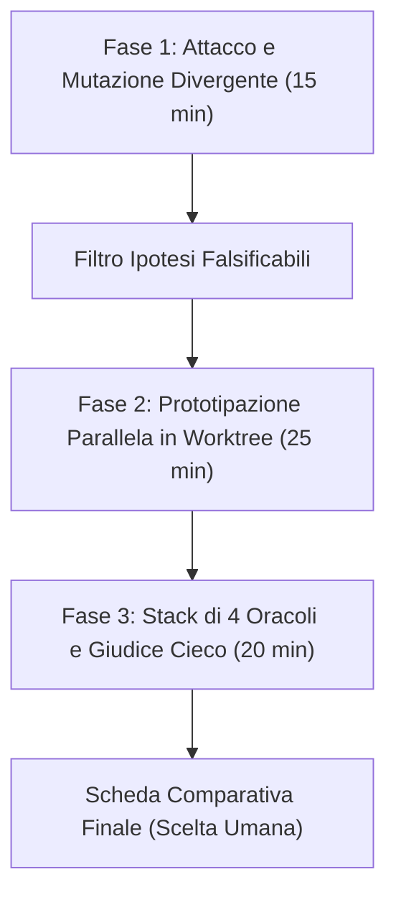

# Piano di Studio: Ciclo di Scoperta Orchestrato Guidato da Oracoli (`oracle-guided-discovery-loop`)

> **Istruzione per l'Agente (Sessione Locale o Cloud)**: esegui questo piano sequenzialmente dalla **Fase A** alla **Fase D**. Usa esclusivamente percorsi relativi al repository o `~` (zero percorsi assoluti di macchina). Preserva il vincolo di **0 byte netti aggiuntivi** sui file `plugins/*/rules/AGENTS.md` (tetto aggregato `48 KB` verificato da [`scripts/validate.mjs`](../../scripts/validate.mjs)).

---

## 1. Obiettivo, Tesi Architetturale e Confini Anti-Rumore

Progettare un protocollo di esplorazione lunga (`>= 60` minuti) orchestrata su più agenti per far emergere miglioramenti non incrementali su software, algoritmi e interfacce, evitando i fallimenti tipici dei cicli non ancorati:

1. **Tesi Centrale (*Mutazione -> Oracolo -> Selezione*)**: sessioni prolungate in cui personalità "stupide", irrazionali o divergenti discutono liberamente tra loro tendono a produrre caricature facili da scartare, consenso fittizio (*hallucinated consensus*) e deriva di contesto dopo `20-30` turni. Al contrario, quelle stesse personalità diventano efficaci **operatori di mutazione** (schema *Quality-Diversity / MAP-Elites*) quando ogni ipotesi o variante generata viene filtrata da **oracoli oggettivi esterni** che scartano automaticamente circa il `90%` del rumore prima della revisione umana.
2. **Posizionamento e Anti-Collisione nel Catalogo**:
   - [`skizzo`](../../plugins/skizzo/README.md) governa il dibattito dialettico rapido all'interno del singolo turno (`2..4` tracce).
   - [`ab-bench`](../../plugins/ab-bench/README.md) fornisce il protocollo di confronto cieco a 5 Dita tra due candidati A/B.
   - [`mapek`](../../plugins/mapek/README.md) e [`nightly-interaction-lab`](./nightly-interaction-lab.md) analizzano retrospettivamente il metodo operatore.
   - [`engineering-workflow`](../../plugins/engineering-workflow/README.md) fornisce `diff-triage.mjs` e la sonda geometrica `ui-geometry-probe.js`.
   - Questo flusso nasce quindi come **capacità pure-skill / workflow on-demand a `0 B` inline**, che coordina sessioni esplorative lunghe tramite la skill built-in `run-workflow` (orchestrazione Python `parallel` / `pipeline` / `phase`) e worktree isolati (`workspace="share"` / `"branch"`), senza mai alterare il branch principale prima della decisione dell'utente.

---

## 2. Architettura a 3 Fasi Temporizzate (~60 min) e Stack di 4 Oracoli Oggettivi

### A. Tre Archetipi di Mutatori Agnostici al Dominio
In coerenza con la regola *Anti-Example Hardcoding* di [`skill-governance`](../../plugins/skill-governance/rules/AGENTS.md), i ruoli mutatori non codificano esempi fissi di un singolo prodotto, ma definiscono tre meccanismi generali di perturbazione:

1. **Utente Distratto / Avversario Cognitivo**: esamina solo le schermate finali (mobile e desktop) senza leggere il codice sorgente, rispondendo entro un vincolo temporale stretto (`3-5` secondi) a domande operative concrete; ogni esitazione o errore di lettura segnala un difetto di chiarezza reale.
2. **Abolizionista a Vincoli Estremi**: applica un taglio forzato del `40-50%` della superficie visiva, dei controlli o dei parametri mostrati, dimostrando dove migra l'informazione necessaria senza perdita decisionale.
3. **Scettico / Fuzzer di Dominio**: sfida le euristiche correnti contro un modello nullo minimale, genera migliaia di scenari limite sintetici e misura gli scarti rispetto a dati storici o telemetria reale.

### B. Stack di 4 Oracoli Oggettivi (Filtro Anti-Rumore)

| Oracolo | Meccanismo di Verifica | Cosa Scarta Automaticamente |
| :--- | :--- | :--- |
| **1. Oracolo Empirico (Dati Reali)** | Backtest/hindcast offline su archivi storici, sensori o log reali | Formule eleganti ma meno accurate della baseline |
| **2. Oracolo di Invarianza & Fuzzing** | Suite deterministica su migliaia di casi limite e dati parziali | Contraddizioni tra viste e casi patologici non gestiti |
| **3. Oracolo Cognitivo Cieco** | Subagente read-only vergine interrogato sui soli screenshot | Interfacce che passano il layout ma confondono l'utente |
| **4. Oracolo Tecnico & Cieco (`/ab-bench`)** | `npm test`, `ui-geometry-probe.js`, `diff-triage.mjs` e 5 Dita | Regressioni, overlap DOM/SVG e bias di presentazione |

---

## 3. Roadmap di Implementazione in 4 Fasi (`Fase A -> Fase D`)

### Fase A — Posizionamento & Audit Anti-Collisione
- Eseguire l'audit con `skill-collision-check` rispetto a `skizzo`, `ab-bench`, `mapek` e alle skill built-in `run-workflow` e `generative_ui`.
- Decidere il contenitore canonico: estensione pure-skill di `plugins/ab-bench` (`v1.1.0`) oppure nuovo plugin puro `plugins/discovery-lab` (`0 B` in `rules/AGENTS.md`).

### Fase B — Motore Headless (`core/discovery-engine.mjs`)
- Implementare in puro Node.js (zero dipendenze DOM, zero chiamate live):
  - Ranking multi-oracolo con frontiera di Pareto tra varianti concorrenti.
  - Guardiano di budget (tempo massimo per fase, tetto chiamate e hard-stop *circuit breaker*).
  - Sanificazione anti-bias delle varianti (rimozione di nomi, razionali persuasivi o metadati autore prima del passaggio al giudice cieco).
  - Contratti JSON deterministici `discovery-brief.json` e `discovery-verdict.json`.

### Fase C — Template Orchestrazione Python & Scheda Comparativa Visiva
- Fornire `references/discovery_workflow_template.py` compatibile con `run_workflow` (`parallel` in Fase 1, worktree `workspace="share"` in Fase 2, `phase` di validazione e giudizio cieco in Fase 3).
- Integrare il confronto cieco a 5 Dita di `/ab-bench` sugli artefatti sopravvissuti agli oracoli.
- Produrre la scheda comparativa finale (screenshot affiancati, tabella metriche Prima/Dopo e delta di complessità) delegando qualsiasi resa HTML interattiva alla skill built-in `generative_ui`.

### Fase D — Skill On-Demand `SKILL.md` (`Hybrid EN/IT`), Suite Offline & Pilota
- Redigere `SKILL.md` (`<= 200` righe, logica imperativa in `EN` e template/output utente in `IT`).
- Aggiungere una suite di test offline (`< 1s`, fixture locali) a copertura del motore Pareto, della sanificazione anti-bias e dei limiti di budget.
- Eseguire 1 ciclo pilota completo su un modulo reale misurando il rapporto tra varianti generate, varianti scartate dagli oracoli e miglioramenti effettivamente promossi dall'utente.

---

## 4. Oracoli di Collaudo Finale (alla chiusura dell'implementazione)

1. `npm test` -> `100%` test verdi offline (`< 3s`), zero chiamate API live.
2. `node scripts/validate.mjs --all` -> `0` errori, `0` warning, `0 B` netti aggiunti al budget aggregato inline (`<= 48.000 B`).
3. Verifica su 1 ciclo pilota end-to-end: consegna di una scheda comparativa oggettiva con zero modifiche su `main` fino a esplicita approvazione umana.
