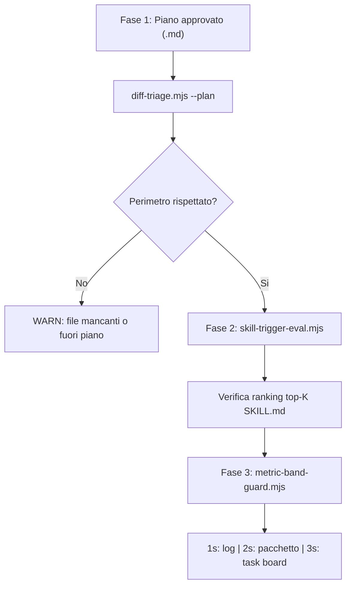

# Piano Esecutivo: Tre Innesti Chirurgici da AI-Native SDLC (`sdlc-three-grafts`)

> **Istruzione per l'Agente (Sessione Locale o Cloud)**: esegui questo piano in **3 fasi atomiche indipendenti** (`Fase 1 -> Fase 2 -> Fase 3`), oppure esegui la singola fase richiesta dall'utente. Usa esclusivamente percorsi relativi al repository o `~` (zero percorsi assoluti di macchina). Rispetta il vincolo di **0 byte netti aggiuntivi** sui file `plugins/*/rules/AGENTS.md` (tetto aggregato `48 KB` verificato da [`scripts/validate.mjs`](../../scripts/validate.mjs)).

---

## 1. Obiettivo e Invarianti Architetturali

Integrare nell'ecosistema `antigravity-plugins` i soli 3 meccanismi ad alto rendimento emersi dal confronto con *The AI-Native SDLC Playbook* (Anthropic), scartando la burocrazia multi-ruolo (`intent.md` + `spec.md` + `REVIEW.md` separati) e preservando l'economia dei token:

1. **Innesto 1 — Verifica di Deriva `Piano <-> Diff` (`engineering-workflow` `v1.4.0`)**: controllo deterministico a `0` token che incrocia i file promessi in un piano approvato (`.agents/plans/*.md` o `docs/PLAN*.md`) con i file effettivamente toccati in `git diff`, segnalando file dimenticati o modifiche fuori perimetro.
2. **Innesto 2 — Regressione Trigger delle Skill (`skill-governance` `v1.1.0`)**: suite deterministica offline (`< 1s`, `0` chiamate API live) che verifica su un corpus dichiarativo di casi d'uso che le modifiche alle `description` in `SKILL.md` non spengano né confondano l'attivazione delle skill installate.
3. **Innesto 3 — Guardiano Deterministico a Bande `1σ / 2σ / 3σ` (`execution-guard` `v1.1.0` + `cognitive-persistence` `v1.7.0`)**: motore puro Node.js e script di guardia riutilizzabile nei progetti applicativi in produzione che valuta metriche rispetto a bande di controllo configurabili (`bands.json`), logga a `1σ`, prepara il pacchetto diagnostico a sola lettura a `2σ` e apre/accoda un task strutturato compatibile con [`gh-board-sync.mjs`](../../plugins/cognitive-persistence/scripts/gh-board-sync.mjs) a `3σ`.

> [!IMPORTANT]
> **Vincoli Invarianti di Progetto**:
> - **Zero Byte Inline Extra**: nessuna aggiunta a `plugins/*/rules/AGENTS.md` che faccia crescere il budget inline; tutta la logica vive in `core/*.mjs`, `scripts/*.mjs` e skill su richiesta (`SKILL.md`).
> - **Zero Chiamate Live nei Test (`execution-guard`)**: ogni suite `*.test.mjs` usa fixture locali o `--mock` con esecuzione `< 3s` e timeout di sicurezza a `45s` negli script CLI.
> - **Zero Esempi Utente Cablati (`skill-governance`)**: il motore di matching delle skill non contiene frasi utente cablate nel codice sorgente; legge schemi generici e file di fixture dichiarativi.

---

## 2. Flusso Operativo dei Tre Innesti

---

## 3. Dettaglio Implementativo per Fase

### Fase 1 — Verifica di Deriva `Piano <-> Diff` (`plugins/engineering-workflow` `v1.3.0 -> v1.4.0`)

1. **Estensione Puro Core in [`plugins/engineering-workflow/core/review-guard-engine.mjs`](../../plugins/engineering-workflow/core/review-guard-engine.mjs)**:
   - `extractPlannedPathsFromMarkdown(planMarkdown)`: estrae e normalizza (`unwrapNormalizedPath`) i percorsi file/directory citati nel piano (link Markdown `[...](...)`, code span `` `path/to/file.ext` `` con almeno un separatore `/` o estensione codice/test valida), escludendo file cognitivi standard (`MEMORY.md`, `WORKLOG.md`, `DESIDERATA.md`, `NOTES.md`) e comandi shell.
   - `compareDiffAgainstPlan(changedFiles, plannedPaths, options)`: restituisce `{ status: 'ALIGNED' | 'DRIFT_WARN', matchedFiles, unplannedFiles, untouchedPlannedFiles, coveragePercent }`, distinguendo tra file di piano espliciti e file di test correlati (sempre ammessi come estensione virtuosa).
2. **Estensione CLI in [`plugins/engineering-workflow/scripts/diff-triage.mjs`](../../plugins/engineering-workflow/scripts/diff-triage.mjs)**:
   - Supporto al flag opzionale `--plan <path>` (più auto-discovery opzionale `--auto-plan` se nel diff stesso compare un file `.agents/plans/*.md` modificato/creato).
   - Sezione `[PLAN vs DIFF ALIGNMENT]` nel report umano e chiave `planAlignment` nell'output `--json`. Non blocca con exit `2` di default (`WARN` informativo, promuovibile a blocco con `--strict-plan`), così l'agente può o completare lo step dimenticato o aggiornare il piano nello stesso commit.
3. **Aggiornamento Skill `/review-diff`**:
   - Aggiornare [`plugins/engineering-workflow/skills/review-diff/SKILL.md`](../../plugins/engineering-workflow/skills/review-diff/SKILL.md) documentando `--plan <path>` e la regola di sincronizzazione piano-codice nello stesso commit.
   - Bump versione in [`plugins/engineering-workflow/plugin.json`](../../plugins/engineering-workflow/plugin.json) a `1.4.0` e aggiornamento `README.md`.
4. **Test dedicati (`plugins/engineering-workflow/tests/plan-drift.test.mjs`)**:
   - Estrazione percorsi da link Markdown relativi (`../../plugins/...`) e code span, filtro falsi positivi (`npm test`, URL `https://...`), rilevamento `untouchedPlannedFiles` e `unplannedFiles`.

---

### Fase 2 — Regressione Automatica di Attivazione Skill (`plugins/skill-governance` `v1.0.0 -> v1.1.0`)

1. **Motore Lessicale/Semantico Deterministico (`plugins/skill-governance/core/trigger-eval-engine.mjs`)**:
   - Indicizza tutti i file `plugins/*/skills/*/SKILL.md` leggendo `name` e `description` dal frontmatter YAML.
   - Calcola un punteggio deterministico `BM25 + copertura bigrammi + penalità collisione` tra un intent di test e l'intero catalogo attivo, restituendo la classifica `topK` (`default: 3`) e il margine di confidenza tra 1° e 2° classificato (`marginScore`).
2. **Fixture Dichiarativa di Regressione (`plugins/skill-governance/references/skill-trigger-cases.json`)**:
   - Schema pulito `{ id, query, expectedSkill, forbiddenSkills?: string[], maxRank?: 1 | 2 }` con almeno 1 caso canonico per ciascun plugin dotato di skill del catalogo, mantenuto come suite di non-regressione dei contratti di attivazione.
3. **CLI & Integrazione Validazione (`plugins/skill-governance/scripts/skill-trigger-eval.mjs`)**:
   - Flag `--cases <path>`, `--skills-root <path>`, `--json` e timeout guardia `45s`.
   - Segnala `FAIL` (exit `1`) se una `expectedSkill` scende sotto `maxRank` o se una `forbiddenSkill` la scavalca dopo un refactoring di `description`.
   - Agganciabile sia da `npm test` (tramite `plugins/skill-governance/tests/trigger-eval.test.mjs`) sia come controllo pre-rilascio in `/skill-audit` e nel futuro `interaction-lab`.
4. **Documentazione e Versionamento**:
   - Aggiornare [`plugins/skill-governance/skills/skill-audit/SKILL.md`](../../plugins/skill-governance/skills/skill-audit/SKILL.md), [`plugins/skill-governance/README.md`](../../plugins/skill-governance/README.md) e portare [`plugins/skill-governance/plugin.json`](../../plugins/skill-governance/plugin.json) a `1.1.0`.

---

### Fase 3 — Bande di Controllo Deterministiche `1σ / 2σ / 3σ` (`execution-guard` `v1.1.0` + `cognitive-persistence` `v1.7.0`)

1. **Motore Statistico a Bande (`plugins/execution-guard/core/control-bands-engine.mjs`)**:
   - Funzione pura `evaluateMetricAgainstBands(sample, bandSpec, history)` senza dipendenze esterne:
     - Supporta sia soglie esplicite (`warn1`, `diag2`, `crit3`) sia calcolo automatico media/deviazione standard (`mean`, `stdDev`, `zScore`) su finestra mobile con protezione divisione per zero (`minStdDevFloor`) e anti-flapping (`consecutiveBreachesRequired`, `cooldownMinutes`).
     - Classifica ogni metrica in 4 livelli:
       - `NORMAL (< 1σ)`: nessuna azione (`0` I/O extra, `0` token).
       - `BAND_1_LOG (>= 1σ)`: riga strutturata append-only su log locale.
       - `BAND_2_DIAGNOSE (>= 2σ)`: genera un pacchetto diagnostico JSON/Markdown compatto (`<= 4 KB`, sola lettura, con contesto metrica, storico recente e ultimo `git rev-parse --short HEAD`) pronto per un'ispezione agente senza permessi di scrittura.
       - `BAND_3_ESCALATE (>= 3σ)`: genera un payload strutturato di anomalia (`intent` di manutenzione) con deduplica per `fingerprint` per non inondare la board.
2. **CLI Guardiano Riutilizzabile (`plugins/execution-guard/scripts/metric-band-guard.mjs`)**:
   - Invocabile da cron/CI/app esterne: `node metric-band-guard.mjs --config bands.json --input metrics.json [--emit-board-issue] [--mock]`.
   - Timeout rigido `45s`, rotazione stato locale e template di riferimento in `plugins/execution-guard/references/bands.template.json`.
3. **Ponte verso la Board in [`plugins/cognitive-persistence/scripts/gh-board-sync.mjs`](../../plugins/cognitive-persistence/scripts/gh-board-sync.mjs)**:
   - Aggiungere funzione esportata `buildMaintenanceIssueFromBandAlert(alertPayload)` e flag CLI `--from-band-alert <jsonFile>` (con supporto `--mock` offline) che trasforma una violazione `3σ` in una issue GitHub etichettata `maintenance-band-3s` (o voce `📥` locale se `LOCAL_ONLY`) con `fingerprint` anti-duplicato verificato prima della creazione.
4. **Skill / Documentazione & Test (`plugins/execution-guard/tests/control-bands.test.mjs`)**:
   - Documentare l'uso delle bande in `plugins/execution-guard/skills/task-watchdog/SKILL.md` (senza toccare `rules/AGENTS.md`), aggiornare manifest (`execution-guard` `1.1.0`, `cognitive-persistence` `1.7.0`) e verificare in test offline: calcolo `1σ/2σ/3σ`, cooldown anti-tempesta, deduplica `fingerprint` e ponte `--mock` verso `gh-board-sync.mjs`.

---

## 4. Oracoli di Collaudo Finale (da eseguire a fine implementazione)

1. `npm test` -> `100%` suite verdi (incluse le 3 nuove suite `plan-drift.test.mjs`, `trigger-eval.test.mjs`, `control-bands.test.mjs`), `0` chiamate di rete reali.
2. `node scripts/validate.mjs --all` -> `0` errori, `0` warning, budget aggregato `rules/AGENTS.md + GEMINI.md <= 48.000 B` invariato e tetti dei 4 file cognitivi rispettati.
3. `node plugins/engineering-workflow/scripts/diff-triage.mjs --plan .agents/plans/sdlc-three-grafts.md` -> auto-verifica reale dell'Innesto 1 sul diff stesso della lavorazione.
4. `node plugins/skill-governance/scripts/skill-trigger-eval.mjs` -> `100%` casi canonici di trigger promossi sul catalogo reale.
5. `node plugins/proactive-mentorship/scripts/session-miner.mjs --verify-and-sync` + `node scripts/sync-to-global.mjs` -> allineamento catalogo globale `~/.gemini`.
