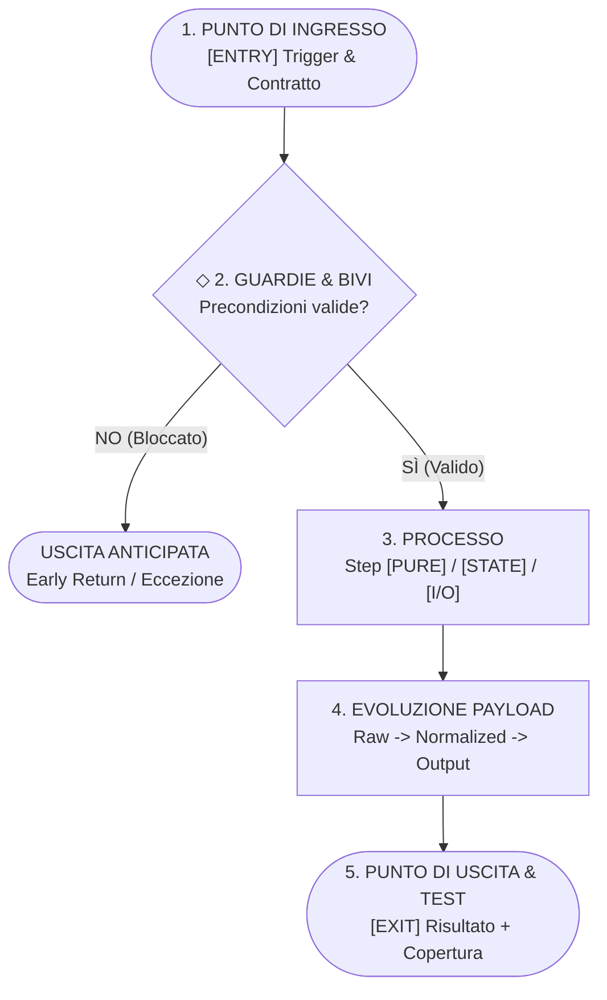

# Antigravity Plugin: Code Inspector & Execution Flow Verification

Plugin per Google Antigravity progettato per assistere lo sviluppatore nella **comprensione rapida, nel recupero del contesto mentale e nella verifica a livello di codice** di funzionalità software esistenti tramite il modello **IPO Esteso (Punto di Ingresso $\to$ Guardie $\to$ Processo $\to$ Punto di Uscita)** e selettori espandibili `<details>` con il codice sorgente reale.

---

## Obiettivo del Plugin (Goal)

Quando un programmatore riprende in mano un modulo scritto mesi prima o analizza un sottosistema non familiare per verificarne il comportamento, le spiegazioni tradizionali degli assistenti AI soffrono di due limiti opposti:
1. **Riassunti astratti non verificabili**: descrizioni discorsive di alto livello prive di riferimenti alle righe di codice, che omettono clausole di guardia silenziose (`early returns`) o mutazioni collaterali di stato.
2. **Sovraccarico cognitivo (Wall of Code)**: riversamento nella chat di centinaia di righe di codice non filtrate che rendono difficile distinguere il flusso principale dai dettagli accessori.

Il plugin `code-inspector` risolve questo problema strutturando ogni analisi su due livelli a divulgazione progressiva:
- **Livello 1 (Mappa Esecutiva IPO + Diagnostica)**: diagramma visuale `mermaid`, tabella `Ingresso -> Processo -> Uscita` con classificazione `[PURE]` / `[STATE]` / `[I/O]`, elenco delle guardie bloccanti, evoluzione della forma del payload e stato della copertura test.
- **Livello 2 (Selettori a Espansione `<details>`)**: blocchi fisarmonica nativi in Markdown che racchiudono gli estratti chirurgici (10–35 righe) del codice coinvolto in ciascuno step, completi di link cliccabili `file://` alle linee esatte.

---

## Componenti del Plugin

| Componente | Tipo | Percorso | Funzione |
| :--- | :--- | :--- | :--- |
| **Regola di Ispezione IPO** | Regola attiva | [`rules/AGENTS.md`](./rules/AGENTS.md) | Impone il modello IPO Esteso, la marcatura `[PURE]`/`[STATE]`/`[I/O]`, la sintassi GFM per `<details>` e il divieto di congetture non verificate sui file sorgente. |
| **`how-its-made`** | Skill on-demand (`/how-its-made`) | [`skills/how-its-made/SKILL.md`](./skills/how-its-made/SKILL.md) | Runbook operativo a 5 step per ricostruire la catena di chiamate, tracciare il payload, estrarre il codice nei selettori espandibili e verificare i test associati. |
| **Template Widget Selettore** | Reference HTML (`<agent-embed>`) | [`skills/how-its-made/references/flow-widget-template.html`](./skills/how-its-made/references/flow-widget-template.html) | Widget interattivo con selettore a tab (`Albero Testuale` \| `Grafico a Blocchi`) incorporato inline nella chat. |
| **Template di Output** | Reference ausiliario | [`skills/how-its-made/references/inspection-template.md`](./skills/how-its-made/references/inspection-template.md) | Struttura Markdown standardizzata per la generazione dei report di ispezione. |
| **Esempio Reale** | Esempio ausiliario | [`skills/how-its-made/examples/sample-inspection.md`](./skills/how-its-made/examples/sample-inspection.md) | Dimostrazione completa di output `/how-its-made` applicato a `scripts/validate.mjs`. |

---

## Architettura dell'Ispezione (`/how-its-made`)



### I 4 Elementi Diagnostici Integrati

1. **Guardie e Uscite Anticipate (`Early Returns`)**:
   Mappa tutte le condizioni che interrompono silenziosamente o con eccezione il flusso prima del processo centrale.
2. **Isolamento della Purezza Computazionale (`[PURE]` vs `[STATE]` vs `[I/O]`)**:
   Consente di individuare a colpo d'occhio quali funzioni calcolano valori deterministici e quali mutano lo stato o effettuano operazioni di I/O.
3. **Tracciamento del Payload (`Data Shape Evolution`)**:
   Documenta come si trasforma la struttura dell'oggetto/dato dall'ingresso grezzo fino al valore emesso in uscita.
4. **Stato di Verifica (`Test Coverage`)**:
   Collega direttamente i test esistenti che coprono la funzionalità e segnala i rami o le guardie ancora scoperti.

---

## Prompt di Esempio

- `/how-its-made validatePlugin`
- *"Usa `/how-its-made` per mostrarmi punto di ingresso, processo, punto di uscita e codice coinvolto nella sincronizzazione dei plugin."*
- *"Devo rimettere mano al flusso di autenticazione: esegui `/how-its-made` evidenziando le guardie di sicurezza, dove cambia lo stato e quali test lo coprono."*

---

## Modalità di Installazione

Per installare e attivare il plugin nella configurazione globale di Antigravity (`~/.gemini/config/plugins/`):

```bash
npm run sync
```

Dopo la prima sincronizzazione, ricaricare la finestra dell'IDE (`Ctrl+Shift+P` $\to$ `Developer: Reload Window`) per rendere immediatamente disponibile il comando slash `/how-its-made` nell'autocompletamento della chat.
