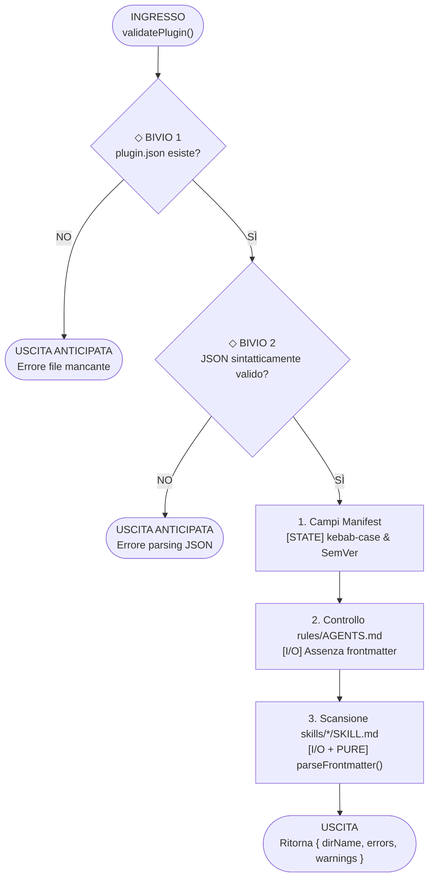

# Esempio Completo di Output `/how-its-made`

Di seguito è riportato un esempio concreto di utilizzo di `/how-its-made` applicato alla funzionalità di validazione di un plugin in [`scripts/validate.mjs`](file:///c:/github/antigravity-plugins/scripts/validate.mjs).

---

## Ispezione Flusso: `validatePlugin(pluginDir, existingNames)`

**Sintesi Tecnica**: Valida la conformità strutturale e sintattica di una directory di plugin verificando il manifest `plugin.json`, l'assenza di frontmatter YAML nelle regole `rules/AGENTS.md` e l'integrità dei metadati frontmatter in `skills/*/SKILL.md`, restituendo gli array di errori e avvisi accumulati.

### 1. Mappa dei Rami e dei Bivi (Ingresso -> Processo -> Uscita)

#### A. Albero Decisionale a Grandezza Nativa (Rami & Bivi)
```text
  [INGRESSO] validatePlugin(pluginDir, existingNames) (L56)
      │
      ▼
  ◇ BIVIO 1: Esiste plugin.json su disco? (L62)
      ├── [NO] ──► [USCITA ANTICIPATA] Ritorna { errors: ['File mancante'] }
      │
      └── [SÌ] ──► parseJsonSafe(manifestPath) (L68)
                    │
                    ▼
  ◇ BIVIO 2: Il JSON di plugin.json è valido? (L69)
      ├── [NO] ──► [USCITA ANTICIPATA] Ritorna { errors: [jsonErr] }
      │
      └── [SÌ] ──► prosegue con le verifiche di dominio
                    │
                    ▼
  1. [STATE] Validazione campi manifest e unicità nome (L74-L145)
      ├── Controlla kebab-case e registra nome in existingNames
      └── Verifica SemVer e suggestedPrompts (<= 3)
      │
      ▼
  2. [I/O] Controllo rules/AGENTS.md (L153-L165)
      └── ◇ BIVIO 3: Inizia con '---' (YAML frontmatter)?
           ├── [SÌ] ──► Aggiunge avviso in warnings[]
           └── [NO] ──► Regola conforme
      │
      ▼
  3. [I/O + PURE] Scansione skills/*/SKILL.md (L168-L188)
      └── Estrae name e description tramite parseFrontmatter()
      │
      ▼
  [USCITA] Ritorna { dirName, errors, warnings } (L210)
```

#### B. Grafico Verticale di Flusso (`flowchart TD`)


| Fase | Tipo | Simbolo e Riferimento | Ruolo nel Flusso |
| :--- | :---: | :--- | :--- |
| **Punto di Ingresso** | `[ENTRY]` | [`validatePlugin()`](file:///c:/github/antigravity-plugins/scripts/validate.mjs#L56-L72) | Riceve il percorso del plugin e il `Set` dei nomi già visti. |
| **Step 1** | `[STATE]` | [`validatePlugin()`](file:///c:/github/antigravity-plugins/scripts/validate.mjs#L74-L122) | Controlla `name` (kebab-case), registra il nome in `existingNames`, verifica SemVer e `suggestedPrompts`. |
| **Step 2** | `[I/O]` | [`validatePlugin()`](file:///c:/github/antigravity-plugins/scripts/validate.mjs#L153-L165) | Legge `rules/AGENTS.md` da disco e verifica che non inizi con `---`. |
| **Step 3** | `[I/O]` + `[PURE]` | [`parseFrontmatter()`](file:///c:/github/antigravity-plugins/scripts/validate.mjs#L40-L54) | Legge ogni `SKILL.md` ed estrae `name` e `description` dal blocco YAML. |
| **Punto di Uscita** | `[EXIT]` | [`validatePlugin()`](file:///c:/github/antigravity-plugins/scripts/validate.mjs#L210-L211) | Restituisce l'oggetto `{ dirName, errors, warnings }` al chiamante [`main()`](file:///c:/github/antigravity-plugins/scripts/validate.mjs#L248-L273). |

---

### 2. Guardie (Early Returns) ed Evoluzione del Payload

#### Guardie e Condizioni di Sbarramento
- **Guardia 1 — Manifest Assente** ([`scripts/validate.mjs:L62-L66`](file:///c:/github/antigravity-plugins/scripts/validate.mjs#L62-L66)): se `plugin.json` non esiste su disco, interrompe subito l'ispezione della cartella restituendo `errors: ['File obbligatorio mancante: plugin.json']`.
- **Guardia 2 — JSON Malformato** ([`scripts/validate.mjs:L68-L72`](file:///c:/github/antigravity-plugins/scripts/validate.mjs#L68-L72)): se `parseJsonSafe()` fallisce il parsing, interrompe i controlli successivi restituendo l'errore di sintassi JSON.

#### Tracciamento del Payload (Data Shape Evolution)
1. **Input Grezzo (`[ENTRY]`)**: `(pluginDir: string, existingNames: Set<string>)`
2. **Stato Intermedio (`[PURE]` / `[I/O]`)**: `manifest: { name, displayName, description, version, suggestedPrompts }` + `fm: { name, description }`
3. **Output Finale (`[EXIT]`)**: `{ dirName: string, errors: string[], warnings: string[] }` (se `totalErrors > 0`, `main()` termina con `process.exit(1)`).

---

### 3. Codice Coinvolto (Selettori a Espansione)

<details>
<summary><strong>Ingresso & Guardie [ENTRY / I/O] — validatePlugin() (scripts/validate.mjs:L56-L72)</strong></summary>

Sorgente: [`scripts/validate.mjs:L56-L72`](file:///c:/github/antigravity-plugins/scripts/validate.mjs#L56-L72)

```javascript
function validatePlugin(pluginDir, existingNames) {
  const errors = [];
  const warnings = [];
  const dirName = pluginDir.split(/[\\/]/).pop();

  // 1. plugin.json
  const manifestPath = join(pluginDir, 'plugin.json');
  if (!existsSync(manifestPath)) {
    errors.push('File obbligatorio mancante: plugin.json');
    return { dirName, errors, warnings };
  }

  const { data: manifest, error: jsonErr } = parseJsonSafe(manifestPath);
  if (jsonErr) {
    errors.push(`plugin.json non valido: ${jsonErr}`);
    return { dirName, errors, warnings };
  }
```

</details>

<details>
<summary><strong>Step 1 [STATE] — Validazione Nome e Unicità (scripts/validate.mjs:L74-L89)</strong></summary>

Sorgente: [`scripts/validate.mjs:L74-L89`](file:///c:/github/antigravity-plugins/scripts/validate.mjs#L74-L89)

```javascript
  if (!manifest.name) {
    errors.push('plugin.json: campo "name" mancante');
  } else {
    if (typeof manifest.name !== 'string' || !KEBAB_CASE_REGEX.test(manifest.name)) {
      errors.push(`plugin.json: "name" ('${manifest.name}') deve essere in kebab-case (minuscolo, trattini)`);
    }
    if (existingNames.has(manifest.name)) {
      errors.push(`plugin.json: nome duplicato '${manifest.name}' (già usato da un altro plugin)`);
    } else {
      existingNames.add(manifest.name);
    }
    if (manifest.name !== dirName) {
      warnings.push(`"name" ('${manifest.name}') differisce dal nome cartella ('${dirName}'). L'ID di installazione corrisponderà alla cartella.`);
    }
  }
```

</details>

<details>
<summary><strong>Step 3 & Uscita [I/O + PURE / EXIT] — Scansione SKILL.md e Ritorno (scripts/validate.mjs:L168-L211)</strong></summary>

Sorgente: [`scripts/validate.mjs:L168-L211`](file:///c:/github/antigravity-plugins/scripts/validate.mjs#L168-L211)

```javascript
  const skillsDir = join(pluginDir, 'skills');
  if (existsSync(skillsDir) && statSync(skillsDir).isDirectory()) {
    const entries = readdirSync(skillsDir, { withFileTypes: true });
    for (const ent of entries) {
      if (ent.isDirectory()) {
        const skillFile = join(skillsDir, ent.name, 'SKILL.md');
        if (!existsSync(skillFile)) {
          errors.push(`skills/${ent.name}: manca il file SKILL.md`);
        } else {
          const content = readFileSync(skillFile, 'utf-8');
          const fm = parseFrontmatter(content);
          if (!fm) {
            errors.push(`skills/${ent.name}/SKILL.md: frontmatter YAML mancante o malformato`);
          } else {
            if (!fm.name) errors.push(`skills/${ent.name}/SKILL.md: "name" mancante nel frontmatter`);
            if (!fm.description) errors.push(`skills/${ent.name}/SKILL.md: "description" mancante nel frontmatter`);
          }
        }
      }
    }
  }
  // ...
  return { dirName, errors, warnings };
}
```

</details>

---

### 4. Stato di Verifica e Copertura Test

- **Esecuzione Automatica**: invocato da `npm test` (`node scripts/validate.mjs --all`) su tutti i plugin e template del repository.
- **Punti di Attenzione**: [`parseFrontmatter()`](file:///c:/github/antigravity-plugins/scripts/validate.mjs#L40-L54) esegue uno split riga per riga sul carattere `:`; nel caso di stringhe YAML multi-riga (`>-`), valorizza la chiave con `>-` anziché concatenare le righe indentate successive.
