# Antigravity Plugin: Cognitive Persistence & Project Memory

Plugin per Google Antigravity progettato per garantire la **continuità cognitiva, la cattura di pensieri in corso d'opera (In-Flight Notes) e la persistenza della memoria architetturale** tra sessioni di lavoro indipendenti e riavvii di contesto.

---

## Obiettivo del Plugin (Goal)

Nei flussi di sviluppo assistiti da agenti AI, la perdita di contesto e le osservazioni che emergono durante una lavorazione comportano quattro criticità ricorrenti:
1. **Inquinamento da cambio di contesto (Context-Switch Pollution)**: annotare un'osservazione mentre è aperta un'altra lavorazione spinge l'agente ad analizzare prematuramente codice che il task attivo sta ancora modificando.
2. **Regressioni concettuali**: l'agente reintroduce bug già risolti in precedenza o ricade in incompatibilità note dell'ambiente.
3. **Perdita di Architectural Decision Records (ADR)**: le motivazioni tecniche dietro scelte strutturali complesse non vengono formalizzate e vanno perdute.
4. **Disallineamento sullo stato del progetto**: assenza di una visione chiara e sintetica su quali feature siano realmente implementate, quali parziali e quali ancora pianificate.

Il plugin `cognitive-persistence` risolve questo problema introducendo l'**Architettura Cognitiva 3+1 (`NOTES.md` + Triade Cognitiva)** e quattro comandi operativi disaccoppiati (`/take-note`, `/review-notes`, `/next-step`, `/memory-sync`).

---

## Architettura: Buffer Pre-Desiderata + Triade Cognitiva

Il plugin governa quattro file standard posizionati alla radice del repository di destinazione:

```
<radice-progetto>/
├── NOTES.md                  # Buffer di cattura rapida In-Flight (/take-note) e triage differito (/review-notes)
├── MEMORY.md                 # Registro distillato per dominio dei vincoli stabili (tetto max 200 righe)
├── WORKLOG.md                # Giornale a finestra mobile (Pointer Index: max 15 interventi / <= 300 righe)
├── DESIDERATA.md             # Matrice dello stato di avanzamento delle funzionalità validate
└── .agents/
    ├── worklog.d/            # Schede ADR granulari estese (YYYY-MM-DD_<argomento>.md)
    └── archive/              # Snapshot storici ruotati (MEMORY_v<N>_archive.md, WORKLOG_v<N>_archive.md)
```

### 0. `NOTES.md` (Buffer di Cattura In-Flight & Staging Pre-Desiderata)
Raccoglie osservazioni grezze, dubbi di UX o anomalie notate dall'utente mentre usa l'app o durante un task aperto:
- **Cattura passiva (`/take-note`)**: salva la nota con ID progressivo (`NOTE-XXX`), data/ora e riferimento all'eventuale task `🟡 In Lavorazione` in `DESIDERATA.md`, con **divieto tassativo** per l'agente di ispezionare il codice o interrompere il task attivo.
- **Mostra ed esegui analisi (`/review-notes`)**: a lavorazione conclusa, mostra la tabella delle note aperte (`📥 Da Analizzare`), permette di selezionare quale approfondire ed esegue l'ispezione sul codice aggiornato per promuoverla in `DESIDERATA.md` o implementarla.

### 1. `MEMORY.md` (Vincoli Stabili & Governance Anti-Bloat — Max 200 Righe)
Registra esclusivamente gli invarianti architetturali e la conoscenza empirica non ovvia acquisita durante lo sviluppo (la cronologia degli interventi appartiene a `WORKLOG.md`). Per prevenire l'inflazione del contesto (*context bloat*):
- **Tetto Massimo Rigido (`200 righe`) e Partizionamento per Dominio**: il file è suddiviso in **5–8 sezioni stabili di dominio**; è **vietato l'append cronologico numerato** (`## 175. ...`).
- **Aggiornamento In-Place e Formato a 2 Punti**: le nuove regole vengono fuse *in-place* nella sezione di dominio pertinente (sostituendo i vincoli superati) con il formato compatto `- **<Invariante>**:` $\to$ `- *Insidia*: <sintomo e causa radice in 1 riga>` / `- *Regola*: <pattern vincolante in 1-2 righe>`.
- **Graduazione nei Test & Compattazione in `.agents/archive/`**: i vincoli verificabili via codice vengono codificati nei test statici (`shiftLeftGovernance.test.mjs`, `validate.mjs`); quando `MEMORY.md` supera le 200 righe, lo snapshot integrale viene archiviato in `.agents/archive/MEMORY_v<N>_archive.md` e il file attivo viene distillato sotto le 120–150 righe.

### 2. `WORKLOG.md` (Rolling Window & Pointer Index — Max 300 Righe) & `.agents/worklog.d/`
Per prevenire la duplicazione del testo e la crescita illimitata del diario cronologico:
- **Frammento Esteso in `.agents/worklog.d/YYYY-MM-DD_<argomento>.md`**: contiene l'ADR completo (*Contesto & Motivazione*, *Decisioni Architetturali*, *Impatto e Conseguenze*).
- **Pointer Record in `WORKLOG.md` (Zero Copia Integrale)**: in `WORKLOG.md` viene inserito esclusivamente un indice puntatore di 4–5 righe (`Tipo`, link cliccabile al file in `.agents/worklog.d/` e 1–2 bullet di sintesi).
- **Finestra Mobile (`Max 15 Interventi` / $\le 300\text{ righe}$) e Log Rotation**: `WORKLOG.md` espone in testa l'*Indice Sintetico delle Fasi Consolidate* seguito dagli ultimi 10–15 interventi; le voci più vecchie vengono ruotate in `.agents/archive/WORKLOG_v<N>_archive.md`.

### 3. `DESIDERATA.md` (Matrice di Stato Funzionale)
Mappa l'intero ciclo di vita delle funzionalità tramite uno schema tabellare con indicatori di stato espliciti:
- `🔴 Prioritario` / `🔴 Pianificato`: requisito architetturale o funzionale validato e pronto per l'avvio.
- `🟡 In Lavorazione`: modulo con implementazione parziale o in fase di test.
- `🟢 Completato`: funzionalità implementata, verificata da test e documentata.

---

## Componenti del Plugin

| Componente | Tipo | Percorso | Funzione |
| :--- | :--- | :--- | :--- |
| **Regola di Condotta** | Regola attiva | [`rules/AGENTS.md`](./rules/AGENTS.md) | Governa l'isolamento cognitivo durante `/take-note`, il triage differito con `/review-notes`, l'avvio `/next-step`, la chiusura `/memory-sync` e le guardie anti-bloat di `MEMORY.md` ($\le 200$ righe) e `WORKLOG.md` ($\le 300$ righe). |
| **`take-note`** | Skill / Comando Slash | [`skills/take-note/SKILL.md`](./skills/take-note/SKILL.md) | Cattura pensieri singoli o multipli in `NOTES.md` a zero cambio di contesto (nessuna lettura codice sorgente, conferma in 1 riga, ripresa immediata del task attivo). |
| **`review-notes`** | Skill / Comando Slash | [`skills/review-notes/SKILL.md`](./skills/review-notes/SKILL.md) | Mostra il cruscotto delle note aperte in `NOTES.md`, consente di selezionare quali esaminare ed esegue il task di analisi approfondita sul codice per promuoverle in `DESIDERATA.md`. |
| **`next-step`** | Skill / Comando Slash | [`skills/next-step/SKILL.md`](./skills/next-step/SKILL.md) | Runbook di accoglienza requisiti invocabile con `/next-step`: scansiona `DESIDERATA.md`, recupera vincoli da `MEMORY.md`, commuta lo stato in `🟡 In Lavorazione` e produce il briefing operativo. |
| **`memory-sync`** | Skill / Comando Slash | [`skills/memory-sync/SKILL.md`](./skills/memory-sync/SKILL.md) | Runbook operativo di fine task: redige il frammento esteso in `worklog.d/`, aggiunge il *Pointer Record* in `WORKLOG.md` (con rotazione oltre 15 voci), aggiorna `MEMORY.md` *in-place* per dominio e allinea `DESIDERATA.md` e `NOTES.md`. |
| **`set-chat-title`** | Script di utilità | [`scripts/set-chat-title.mjs`](./scripts/set-chat-title.mjs) | Script Node.js che comunica via Connect-RPC con Antigravity Language Server per aggiornare istantaneamente il titolo della conversazione nella sidebar e nel database. |

---

## Ciclo Operativo Integrato

```mermaid
flowchart TD
    subgraph InFlight ["0. Cattura In-Flight & Triage (/take-note & /review-notes)"]
        N1["Invocazione /take-note <testo>"] --> N2["Scrittura in NOTES.md (NOTE-XXX)<br/>+ Tag Lavorazione Attiva<br/>(Zero analisi codice / Zero interruzione)"]
        N2 -. "A lavorazione conclusa" .-> N3["Invocazione /review-notes"]
        N3 --> N4["Mostra Cruscotto Note Aperte<br/>+ Esecuzione Task Analisi sul Codice"]
        N4 --> N5["Promozione in DESIDERATA.md (🔴)<br/>e consolidamento nota in NOTES.md (✅)"]
    end

    subgraph Avvio ["1. Start-of-Task (/next-step)"]
        N5 --> A["Invocazione /next-step"]
        A --> B["Scansione DESIDERATA.md<br/>(Ripresa 🟡 o selezione primo 🔴)"]
        B --> C["Iniezione Vincoli MEMORY.md<br/>& Rolling Window WORKLOG.md"]
        C --> D["Transizione stato: 🟡 In Lavorazione<br/>+ Ridenominazione Chat (set-chat-title.mjs)<br/>+ Briefing Operativo con Prompt"]
    end

    subgraph Sviluppo ["2. Esecuzione & Test"]
        D --> E["Sviluppo TDD & Modifiche Codice"]
        E --> F["Verifica Test Superata: 100%"]
    end

    subgraph Chiusura ["3. End-of-Task Sync (/memory-sync)"]
        F --> G["Redazione Frammento Esteso<br/>(.agents/worklog.d/YYYY-MM-DD_topic.md)"]
        G --> H["Pointer Record in WORKLOG.md (<= 300 righe)<br/>+ Rotazione in .agents/archive/ se > 15 voci"]
        H --> I{"Nuovo invariante non ovvio?"}
        I -- Sì --> L["Update In-Place per Dominio (MEMORY.md <= 200 righe)<br/>o Archiviazione (.agents/archive/) + Distillazione"]
        I -- No --> M["Allineamento Matrice (DESIDERATA: 🟡 ➔ 🟢)"]
        L --> M
        M --> N["Resoconto Finale all'Utente"]
    end
```



---

## Prompt di Esempio

- *"`/take-note <testo dell'osservazione>`"* (registra una o più note al volo senza interrompere la lavorazione corrente)
- *"`/review-notes`"* (mostra la tabella delle note aperte in `NOTES.md` e permette di selezionare su quale avviare il task di analisi approfondita)
- *"`/review-notes NOTE-001`"* (esegue direttamente il task di analisi approfondita sulla nota `NOTE-001`)
- *"`/next-step`"* (cerca il prossimo desiderata pianificato e avvia la lavorazione)
- *"`/memory-sync`"* (esegue la sincronizzazione della memoria di progetto per l'intervento appena completato)

---

## Modalità di Installazione (Sincronizzazione Fisica Globale)

I plugin di Antigravity risiedono fisicamente in `~/.gemini/config/plugins/` (senza Directory Junctions, che vengono ignorate dal Language Server su Windows). Per sincronizzare tutte le modifiche dal repository sorgente:

```bash
npm run sync
```

---

## Sinergia con gli Altri Plugin

- **`laws-of-ux` & `proactive-mentorship`**: durante l'esecuzione di `/review-notes`, l'agente applica le euristiche di ergonomia touch, carico cognitivo e scrutinio critico per trasformare un appunto grezzo in una specifica solida per `DESIDERATA.md`.
- **`engineering-workflow`**: durante l'uso di Git Worktree, il frammento in `worklog.d/` viene scritto nel worktree e consolidato prima del merge su `main`.
- **`execution-guard`**: quando un loop o uno stallo viene interrotto dal circuit breaker, la causa radice dell'invarianza viene trascritta in `MEMORY.md` per impedire iterazioni analoghe nelle sessioni successive.
