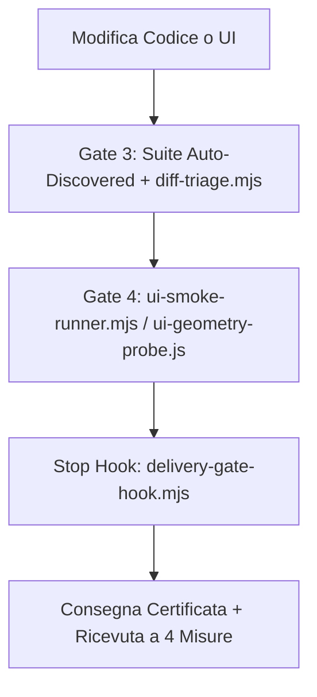

# Antigravity Plugin: Engineering Workflow, Blind Diff Review & Shift-Left Delivery Gates (`v1.3.0`)

Plugin per Google Antigravity che automatizza la **governance Git chirurgica**, la **localizzazione deterministica dei guasti**, l'**integrità della suite di test**, il **triage avversariale dei diff (`/review-diff`)**, il **collaudo UI multi-viewport headless** e la **certificazione meccanica delle ricevute sul transcript (`Stop` hook)**.

---

## Obiettivo del Plugin

Rimuovere il collo di bottiglia di review e collaudo manuale generato dall'uso intensivo di agenti AI tramite quattro difese eseguibili:
1. **Integrità dei test e guardia anti-addomesticamento**: auto-discovery di tutte le suite `*.test.*` e rilevamento automatico su `git diff` di asserzioni preesistenti cancellate/alterate o di *faux-test* tautologici (`assert.ok(true)`).
2. **Pre-review avversariale cieca (`/review-diff`)**: filtraggio del rumore meccanico del diff (-60..80% di righe da leggere) e ispezione in sola lettura tramite subagent isolato `Blind Diff Critic`.
3. **Collaudo UI multi-viewport riproducibile (`ui-smoke-runner.mjs`)**: esecuzione headless automatica dei flussi salvati in `.agents/smoke-flows.json` (`360x800` Mobile, `800x480` Embedded/Raspberry, `1280x800` Desktop) con iniezione di `ui-geometry-probe.js` prima e dopo ogni azione.
4. **Certificazione della consegna sul transcript (`delivery-gate-hook.mjs`)**: hook `Stop` che intercetta modifiche `edit_file`/`write_file` effettuate *dopo* l'ultimo test o prive di verifica UI, forzando un giro di verifica automatica (`decision: "continue"`, circuit breaker 1-retry) prima di disturbare l'operatore umano.

---

## Componenti del Plugin

| Componente | Tipo | Percorso | Funzione |
| :--- | :--- | :--- | :--- |
| **Regola di Condotta** | Regola attiva | [`rules/AGENTS.md`](./rules/AGENTS.md) | Impone Git chirurgico, core headless in inglese, 5 Gate Shift-Left, divieto di addomesticare test e verifica pre-consegna. |
| **Delivery Gate Hook** | Hook `Stop` | [`hooks.json`](./hooks.json) / [`scripts/delivery-gate-hook.mjs`](./scripts/delivery-gate-hook.mjs) | Verifica su `transcript.jsonl` che test e sonda UI siano successivi all'ultimo `edit_file` del turno. |
| **Core Review Engine** | Headless Core | [`core/review-guard-engine.mjs`](./core/review-guard-engine.mjs) | Motore Node.js puro (0 DOM) per parsing `git diff`, test-tamper guard, faux-test guard, transcript gate e ricevuta a 4 misure. |
| **Diff Triage CLI** | Script `L3` | [`scripts/diff-triage.mjs`](./scripts/diff-triage.mjs) | Scansiona `git diff` estraendo solo mutazioni di stato, I/O, sink critici e allarmi di manomissione test. |
| **UI Smoke Runner** | Script `L3` | [`scripts/ui-smoke-runner.mjs`](./scripts/ui-smoke-runner.mjs) | Esegue flussi dichiarativi Playwright multi-viewport iniettando `ui-geometry-probe.js` e producendo la Ricevuta a 4 Misure. |
| **`review-diff`** | Skill on-demand | [`skills/review-diff/SKILL.md`](./skills/review-diff/SKILL.md) | Workflow `/review-diff` con `diff-triage.mjs` e subagent `Blind Diff Critic` in sola lettura. |
| **`shift-left-governance`** | Skill on-demand | [`skills/shift-left-governance/SKILL.md`](./skills/shift-left-governance/SKILL.md) | Protocollo a 5 gate con `ui-geometry-probe.js` e template di governance architetturale. |
| **`trace-debugging`** | Skill on-demand | [`skills/trace-debugging/SKILL.md`](./skills/trace-debugging/SKILL.md) | Localizzazione deterministica dei guasti tramite breadcrumb `[DEBUG-TRACE #X]`. |
| **`worktree-lifecycle`** | Skill on-demand | [`skills/worktree-lifecycle/SKILL.md`](./skills/worktree-lifecycle/SKILL.md) | Gestione di Git Worktrees isolati per sessioni parallele senza collisioni sul disco. |

---

## Comandi Operativi Rapidi

```bash
# 1. Triage deterministico del diff e controllo integrita test su qualunque repo
node c:/github/antigravity-plugins/plugins/engineering-workflow/scripts/diff-triage.mjs --repo "<workspace>"

# 2. Inizializzazione ed esecuzione flussi smoke UI multi-viewport (Mobile + Embedded + Desktop)
node c:/github/antigravity-plugins/plugins/engineering-workflow/scripts/ui-smoke-runner.mjs --repo "<workspace>" --init
node c:/github/antigravity-plugins/plugins/engineering-workflow/scripts/ui-smoke-runner.mjs --repo "<workspace>"

# 3. Verifica manuale di certificazione consegna su un transcript specifico
node c:/github/antigravity-plugins/plugins/engineering-workflow/scripts/delivery-gate-hook.mjs --check --transcript "<transcript.jsonl>"
```

---

## Flusso Automatico di Garanzia Pre-Consegna


