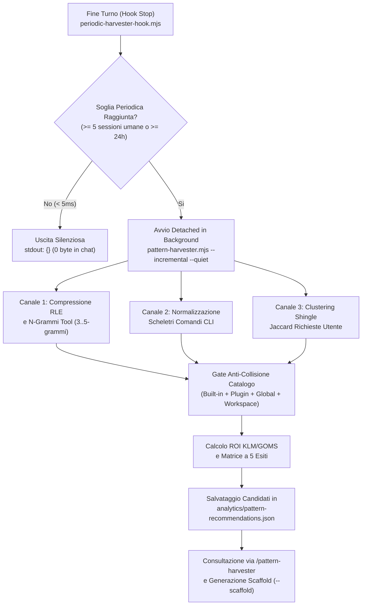

# Pattern Harvester & Automation Advisor (`pattern-harvester`)

Plugin di **Process & Workflow Mining Periodico** per Google Antigravity che ispeziona in modo incrementale le sessioni di lavoro umane (`transcript.jsonl`), le catene di tool call, i comandi CLI e gli archetipi di richiesta per individuare lavorazioni ripetitive non ancora automatizzate e trasformarle in nuove **Skill (`L2b`)**, **Estensioni Script (`L3`)**, **Regole (`L2a`)** o **Plugin**.

---

## 1. Cosa Fa (Posizionamento nell'Ecosistema)

All'interno dell'ecosistema `antigravity-plugins`, `pattern-harvester` colma il divario tra l'osservabilità quantitativa e l'automazione proattiva dei flussi di lavoro:

| Componente | Cosa Osserva | Quando Interviene | Cosa Produce |
| :--- | :--- | :--- | :--- |
| **`telemetry-analytics`** | Volumi di token (`in`/`out`/`cache`), tempi di risposta e conteggi piatti dei tool. | Ad ogni turno e su `/plugin-analytics`. | Footer token a 3 valori, `metrics-summary.json`, Dashboard HTML. |
| **`proactive-mentorship`** | Segnali lessicali di errore, regressione o correzione esplicita dell'utente (*"avviene ancora"*, *"ricordati sempre"*). | Reattivamente *in-flight* quando si verifica un attrito. | Aggiornamento difensivo immediato (`MEMORY.md`, test invariante `L3`, regola `L2a`). |
| **`pattern-harvester`** | **Sequenze ordinate di tool (n-grammi RLE)**, **scheletri strutturali di comandi shell** e **cluster di richieste multi-step** ripetute con successo tra sessioni. | **Periodicamente in background** (ogni `5` sessioni umane o `24h`) e on-demand via `/pattern-harvester`. | **Analisi ROI KLM/GOMS**, filtro anti-collisione sul catalogo attivo e **scaffolding pronto** di nuove `SKILL.md` o `plugin.json`. |

---

## 2. Come Funziona (Architettura in 4 Fasi)



### Fase 1 — Controllo Periodico Silenzioso a Latenza Zero (`Stop` Hook)
Per evitare qualsiasi rallentamento durante la conversazione o interruzioni non richieste ("effetto Clippy"):
1. Al termine del turno (`Stop`), l'hook [`scripts/periodic-harvester-hook.mjs`](./scripts/periodic-harvester-hook.mjs) esegue un controllo rapido (`< 5ms`, protetto da un watchdog di sicurezza a `5s`) sul file di stato `~/.gemini/antigravity/analytics/pattern-harvester-state.json`.
2. Distingue le conversazioni umane reali dai subagent (`Alpha`, `Beta`, `Gamma`) ispezionando esclusivamente l'intestazione del primo step (`isHumanConversationTranscript`).
3. Quando il contatore raggiunge **`5` nuove sessioni umane** dall'ultima analisi (oppure sono trascorse **`24` ore** con almeno una nuova sessione attiva), avvia [`scripts/pattern-harvester.mjs`](./scripts/pattern-harvester.mjs) in un processo **detached in background** (`spawn(..., { detached: true, stdio: 'ignore' }).unref()`) e restituisce immediatamente `{}` su `stdout`.
4. Se non emergono pattern che superano le soglie di convenienza, il plugin mantiene il **silenzio totale (`0 byte` in chat)**.

### Fase 2 — Estrazione Strutturale Astratta a 3 Canali (`core/harvester-engine.mjs`)
Nel rispetto del principio `Anti-Example Hardcoding` (divieto di cablare regex su casi specifici passati), il motore headless [`core/harvester-engine.mjs`](./core/harvester-engine.mjs) estrae impronte strutturali astratte:

1. **Canale 1 — Compressione Run-Length (RLE) e N-Grammi di Tool (`TOOL_CHAIN`)**:
   - Mappa ogni tool call su un token semantico (`READ:FILE`, `READ:SKILL`, `READ:COGNITIVE`, `EDIT:FILE`, `WRITE:TEST`, `EXEC:TEST`, `EXEC:VALIDATE`, `EXEC:SYNC`, `EXEC:GIT`, `ORCHESTRATE:SUBAGENT`, `SEARCH:QUERY`).
   - Comprime le chiamate contigue identiche (es. 4 letture file seguite da 2 modifiche, un test, una validazione e un sync diventano `READ:FILE+ -> EDIT:FILE+ -> EXEC:TEST -> EXEC:VALIDATE -> EXEC:SYNC`).
   - Estrae tutti i `3-grammi`, `4-grammi` e `5-grammi` contenenti almeno un'azione operativa e ne traccia la frequenza su sessioni distinte.
2. **Canale 2 — Scheletri Strutturali dei Comandi CLI (`CLI_SEQUENCE`)**:
   - Analizza gli argomenti `CommandLine` di `run_command` sostituendo UUID (`<uuid>`), percorsi assoluti (`<path>`), stringhe quotate (`"<str>"`) e numeri (`<num>`), ma **preservando i nomi degli script** (`<dir>/validate.mjs`, `<dir>/sync-to-global.mjs`) e i flag strutturali (`--all`, `--verify-and-sync`).
   - Scarta i comandi singoli banali (`git status`, `git diff`, `npm test` isolato) e individua sequenze CLI lanciate a mano in più sessioni che possono diventare uno script `L3` o una skill dedicata.
3. **Canale 3 — Clustering Lessicale per Shingle Jaccard (`INTERACTION_ARCHETYPE`)**:
   - Tokenizza le richieste utente (`USER_INPUT`), rimuove stopword IT/EN, path e blocchi codice, e genera insiemi di token + **2-shingle** di parole adiacenti.
   - Raggruppa i turni tra sessioni diverse quando la similarità di Jaccard è `>= 0.35`, identificando compiti concettualmente identici espressi con parole leggermente diverse.

### Fase 3 — Gate Anti-Collisione e Matrice Decisionale ROI (KLM/GOMS)
Prima di promuovere un pattern, il motore esegue due filtri:

1. **Deduplicazione contro il Catalogo Attivo (`evaluateCatalogOverlap`)**:
   - Indicizza tutte le skill e i plugin già presenti in `plugins/*`, `.agents/skills/` e `~/.gemini/config/skills/`.
   - Se una skill esistente copre già il flusso (`overlap >= 0.75` o la skill è stata letta nel turno senza necessità di passaggi manuali correttivi successivi), il pattern viene classificato come `ALREADY_COVERED` e scartato.
   - Se una skill viene invocata ma seguono sistematicamente `>= 3` passaggi manuali di modifica/esecuzione, il pattern viene classificato come **`SKILL_EXTENSION`** (proponendo di integrare i passaggi mancanti nella skill esistente).
2. **Calcolo del Risparmio Netto (`classifyAndScoreCandidate`)**:
   - Stima il tempo risparmiato per singola esecuzione secondo i parametri KLM/GOMS: `18s` (digitazione prompt e contesto) + `11s x media_step_manuali`.
   - Proietta il risparmio su una finestra di **15 sessioni** sottraendo il costo fisso di setup e conferma (`T_setup = 40s`).
   - Applica la **Matrice Decisionale a 5 Esiti**:

| Esito Classificazione | Condizioni Quantitative Minime | Quando Scatta | Azione Proposta |
| :--- | :--- | :--- | :--- |
| **`IGNORE`** | `< 3` occorrenze **o** `< 2` sessioni **o** `ROI netto < 120s` **o** `ALREADY_COVERED` | Pattern occasionale, micro-task o flusso già coperto da una skill attiva. | Silenzio (`0 byte` in chat). |
| **`RULE_OR_GUARD` (`L2a`/`L3`)** | `>= 2` occorrenze su `>= 2` sessioni (`INVARIANT_CORRECTION`) | Vincolo comportamentale ripetuto o controllo statico verificabile in `< 20` righe. | Regola in `rules/AGENTS.md` o guardia in `scripts/validate.mjs`. |
| **`SKILL_EXTENSION` (`L2b+L3`)** | `>= 3` occorrenze su `>= 2` sessioni con `overlap 0.45..0.74` o step post-skill | Una skill esistente copre metà del lavoro ma richiede sempre passaggi manuali aggiuntivi. | Aggiornamento *in-place* della skill esistente o nuovo script `scripts/`. |
| **`NEW_SKILL` (`L2b`)** | `>= 3` occorrenze su `>= 2` sessioni **e** `ROI netto >= 120s` (`>= 3x` setup) | Procedura sequenziale multi-step attivabile on-demand con un singolo comando `/slug`. | Creazione di `skills/<slug>/SKILL.md` (`<= 200` righe). |
| **`NEW_PLUGIN`** | `>= 4` occorrenze su `>= 3` sessioni **e** `ROI netto >= 240s` + multi-componente | Dominio autonomo che necessita di `hooks.json`, stato persistente, regole e più skill/script. | Creazione di `plugins/<slug>/` completo. |

### Fase 4 — Generazione dello Scaffold Pre-Validato (`--scaffold`) e Cooldown (`--dismiss`)
Quando un pattern viene promosso, `generateCandidateScaffold` costruisce la bozza completa dei file (`SKILL.md` con `description` YAML folded `>-` calibrata tra `80` e `250` caratteri e trigger direttivo `"Utilizza questa skill quando..."`, oppure `plugin.json` SemVer + `rules/AGENTS.md` + `SKILL.md`), già conforme a `node scripts/validate.mjs --all`.

---

## 3. Struttura del Plugin e Riferimento Comandi CLI

```text
plugins/pattern-harvester/
├── plugin.json                                        # Manifest SemVer con 3 suggestedPrompts
├── hooks.json                                         # Hook Stop (periodic-harvester-hook.mjs)
├── README.md                                          # Documentazione architetturale e operativa
├── core/
│   └── harvester-engine.mjs                           # Motore Headless: RLE n-grammi, CLI skeleton, ROI e scaffold
├── rules/
│   └── AGENTS.md                                      # Protocollo periodico e matrice decisionale (<= 6.000 B)
├── scripts/
│   ├── pattern-harvester.mjs                          # Scanner incrementale, CLI report, --scaffold e --dismiss
│   └── periodic-harvester-hook.mjs                    # Trigger leggero su evento Stop (< 5ms hot path)
├── skills/
│   └── pattern-harvester/
│       ├── SKILL.md                                   # Runbook operativo per /pattern-harvester (<= 200 righe)
│       └── references/
│           └── pattern-mining-methodology.md          # Dettaglio algoritmi RLE, Jaccard e formule KLM/GOMS
└── tests/
    └── pattern-harvester.test.mjs                     # Suite di test unitari e di integrazione (node --test)
```

### Comandi CLI Principali

```powershell
# 1. Esegue la scansione delle sessioni umane (default: ultimi 14 giorni, max 40 sessioni)
node c:/github/antigravity-plugins/plugins/pattern-harvester/scripts/pattern-harvester.mjs

# 2. Restituisce il report completo in formato JSON
node c:/github/antigravity-plugins/plugins/pattern-harvester/scripts/pattern-harvester.mjs --json

# 3. Genera lo scaffold pre-validato (SKILL.md o plugin.json) per un pattern specifico
node c:/github/antigravity-plugins/plugins/pattern-harvester/scripts/pattern-harvester.mjs --scaffold <patternId> --slug <nome-skill>

# 4. Silenzia un pattern per 30 giorni se non si desidera automatizzarlo
node c:/github/antigravity-plugins/plugins/pattern-harvester/scripts/pattern-harvester.mjs --dismiss <patternId>
```
