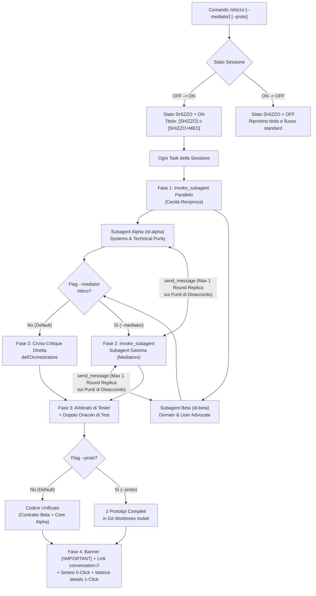

# Antigravity Plugin: Shizzo — Dual-Track Technical vs Domain Dialectics (`v1.1.0`)

Plugin sperimentale di **Adversarial & Collaborative Dual-Track Engineering** per Google Antigravity. Mette in competizione e collaborazione parallela due subagent isolati con mandati ortogonali — **Subagent Alpha (`Systems & Technical Purity Architect`)** e **Subagent Beta (`Domain & User Experience Advocate`)** — con l'opzione di abilitare un terzo **Mediatore Interattivo** (**Subagent Gamma (`Dialectical Mediator & Conflict Resolver`)** tramite `/shizzo --mediator`) incaricato di contro-interrogare i due agenti sui punti di disaccordo ed emettere un lodo arbitrale vincolante.

---

## Obiettivo del Plugin (Goal)

Quando un singolo agente sviluppa una funzionalità, tende inevitabilmente a un compromesso implicito fin dalle prime righe di ragionamento:
1. **Deriva Tecnocentrica**: un'architettura internamente elegante ma che espone complessità, configurazioni manuali o gergo implementativo all'utente finale.
2. **Deriva Superficiale (UI-First)**: un flusso utente apparentemente comodo ma costruito su accoppiamenti stato-DOM, validazioni fragili e assenza di isolamento headless.

Il plugin `shizzo` risolve questo limite strutturale tramite una **scissione controllata a 4 fasi** attivabile on-demand:
- **Dormiente di Default (`OFF`)**: non consuma risorse e non altera il comportamento dell'agente finché non viene attivato.
- **Toggle di Sessione (`/shizzo`)**: una volta attivato (`ON`), applica il protocollo Dual-Track a tutti i task successivi della conversazione (marcando il titolo chat con `[SHIZZO]` o `[SHIZZO+MED]`) finché non viene disattivato.
- **Biforcazione Cieca Parallela (`invoke_subagent`)**: delega sempre in parallelo a 2 subagent indipendenti (`Alpha` e `Beta`) che non vedono il lavoro l'uno dell'altro durante la Fase 1.
- **Mediatore Interattivo Opzionale (`/shizzo --mediator` o `-m`)**: avvia nella Fase 2 un terzo subagent isolato (`Subagent Gamma`) che analizza i conflitti, contro-interroga `Alpha` e `Beta` tramite `send_message` (con circuit breaker di max 1 round di replica) e pronuncia il verdetto arbitrale.
- **Visibilità Esplicita in Output**: ogni risposta generata a modalità attiva si apre al rigo 1 con il banner `> [!IMPORTANT] MODALITÀ SHIZZO ATTIVA` corredato dai link cliccabili `conversation://<id>` per ispezionare il ragionamento interno di ciascun subagent (`Alpha`, `Beta`, `Gamma`).

---

## Componenti del Plugin

| Componente | Tipo | Percorso | Funzione |
| :--- | :--- | :--- | :--- |
| **Protocollo Dual-Track, Mediatore & Dormienza** | Regola attiva | [`rules/AGENTS.md`](./rules/AGENTS.md) | Definisce la Clausola di Dormienza Predefinita (`OFF`), il toggle `/shizzo` (`--mediator`, `--proto`), la delega parallela, la negoziazione peer-to-peer via `send_message`, il banner `[!IMPORTANT]` obbligatorio e la tabella di anti-razionalizzazione. |
| **`shizzo`** | Skill on-demand (`/shizzo`) | [`skills/shizzo/SKILL.md`](./skills/shizzo/SKILL.md) | Runbook autosufficiente con i prompt completi per `Subagent Alpha`, `Subagent Beta` e `Subagent Gamma (Mediatore)` e il template di consegna. |
| **Template Dialettico** | Reference ausiliario | [`skills/shizzo/references/dialectic-template.md`](./skills/shizzo/references/dialectic-template.md) | Modelli per il banner `[!IMPORTANT]`, la matrice comparativa `<details>` 1-Click, il log di negoziazione del Mediatore e la modalità `/shizzo --proto`. |

---

## Architettura del Ciclo a 4 Fasi (`/shizzo` & `/shizzo --mediator`)



### Le 5 Regole Cardine del Protocollo

1. **Cecità Reciproca in Fase 1 (`invoke_subagent` Parallelo)**:
   `Subagent Alpha` e `Subagent Beta` vengono invocati simultaneamente in una singola chiamata tool. Nessuno dei due conosce le scelte dell'altro, prevenendo compromessi annacquati.
2. **Mediazione Interattiva in Fase 2 (`/shizzo --mediator`)**:
   Quando l'opzione `--mediator` è attiva, `Subagent Gamma` riceve i report e i `conversationId` di `Alpha` e `Beta`, li contro-interroga tramite `send_message` sui punti in cui sono in disaccordo (con limite rigido di max 1 round di replica) ed emette un lodo arbitrale motivato.
3. **Arbitrato di Tesler in Fase 3**:
   In base alla Legge della Conservazione della Complessità di Tesler, ogni riduzione di attrito per l'utente (`Beta`) viene preservata nel contratto esterno e pagata tramite un'architettura headless pura e deterministica nel core (`Alpha`).
4. **Doppio Oracolo di Verifica**:
   Nessun task in modalità `shizzo` è completo se il codice non supera sia la suite di unit test sugli invarianti tecnici (`Oracolo Alpha`) sia i test di scenario d'uso (`Oracolo Beta`).
5. **Trasparenza e Ispezionabilità (`Banner [!IMPORTANT]` + `conversation://`)**:
   Ogni risposta inizia con il banner `MODALITÀ SHIZZO ATTIVA` e fornisce i link diretti alle conversazioni dei subagent eseguiti.

---

## Comandi e Prompt di Esempio

- `/shizzo` — Attiva (o disattiva se già attivo) la modalità Dual-Track standard (`[SHIZZO]`) per tutti i task successivi della chat.
- `/shizzo --mediator` (o `/shizzo -m`) — Attiva la modalità Dual-Track con il terzo subagent Mediatore interattivo (`Subagent Gamma`, titolo `[SHIZZO+MED]`).
- `/shizzo --no-mediator` — Disattiva il Mediatore mantenendo attiva la modalità Dual-Track a 2 subagent.
- `/shizzo on` / `/shizzo off` — Forza esplicitamente l'attivazione o il ritorno allo stato dormiente.
- `/shizzo --mediator progetta e implementa il filtro di ricerca multi-criterio con persistenza URL` — Lancia `Alpha` e `Beta` in parallelo, fa risolvere i disaccordi da `Subagent Gamma` via `send_message` e implementa la soluzione unificata.
- `/shizzo --proto rifattorizza il motore di calcolo tariffe` — Genera 2 prototipi completi in Git Worktrees isolati (`shizzo/alpha-tech` e `shizzo/beta-domain`) per il confronto empirico.

---

## Modalità di Installazione

Per sincronizzare e abilitare il plugin nella configurazione globale di Antigravity (`~/.gemini/config/plugins/`):

```bash
npm run sync
```

Dopo la prima sincronizzazione, ricaricare la finestra dell'IDE (`Ctrl+Shift+P` $\to$ `Developer: Reload Window`) per rendere disponibile il comando slash `/shizzo` nell'autocompletamento della chat.
