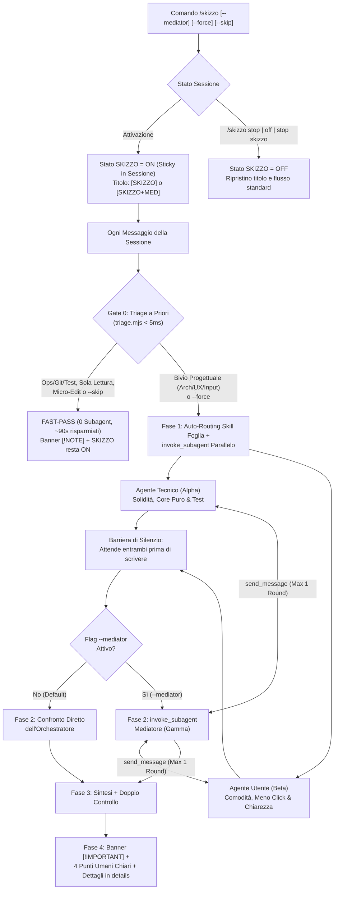

# Antigravity Plugin: Skizzo — Dual-Track Technical vs Domain Dialectics (`v1.5.0`)

Plugin di **Adversarial & Collaborative Dual-Track Engineering** per Google Antigravity. Mette in competizione e collaborazione parallela due subagent isolati con mandati complementari — **Agente Tecnico (`Subagent Alpha — Systems & Technical Purity`)** e **Agente Utente (`Subagent Beta — Domain & User Experience Advocate`)** — con **Filtro Automatico a Priori (`FAST-PASS` vs `DUAL-TRACK` in `< 5ms`)**, auto-routing delle skill specialistiche, **persistenza automatica per l'intera sessione fino al comando di stop**, **Mediatore Interattivo** opzionale (`Subagent Gamma` tramite `/skizzo --mediator`) e restituzione finale **Human-First** in italiano semplice.

---

## Obiettivo del Plugin (Goal)

Quando un singolo agente sviluppa una funzionalità, tende a un compromesso implicito fin dalle prime righe di ragionamento:
1. **Deriva Tecnocentrica**: un'architettura internamente elegante ma che espone complessità, configurazioni manuali o gergo implementativo all'utente finale.
2. **Deriva Superficiale (UI-First)**: un flusso utente apparentemente comodo ma costruito su accoppiamenti stato-DOM, validazioni fragili e assenza di isolamento headless.

Al tempo stesso, lanciare sempre 2 subagent anche per correggere un refuso o fare un commit sprecherebbe ~110 secondi a turno. Il plugin `skizzo` (`v1.5.0`) risolve entrambi i problemi tramite un **Filtro Automatico a Priori (`Gate 0`) + Ciclo a 4 Fasi**:
- **Dormiente a Inizio Nuova Chat (`OFF`)**: non consuma risorse finché non viene attivato.
- **Persistenza Sticky per Tutta la Sessione (`/skizzo`)**: una volta attivato (`ON`), resta **attivo automaticamente su tutti i messaggi successivi della conversazione** fino alla chiusura della chat o a un comando di stop (`/skizzo stop`, `/skizzo off`, `stop skizzo`, `ferma skizzo`).
- **Gate 0 — Filtro Automatico a Priori (`FAST-PASS` vs `DUAL-TRACK`, `< 5ms`)**: prima di avviare subagent, valuta se il messaggio richiede una scelta progettuale:
  - Su **comandi operativi/Git/test/memoria**, **domande di sola lettura** e **micro-correzioni puntuali a scelta unica** (o conferme esecutive come *"fallo"* / *"procedi"*), risponde subito in **`FAST-PASS` (`0` subagent, ~90–120s risparmiati)** mostrando un avviso di 1 riga (`[!NOTE]`) e **restando attivo** per i turni successivi.
  - Su **nuove funzionalità, piani, flussi utente/input o refactoring multi-file**, avvia in automatico il **Ciclo a 4 Fasi (`DUAL-TRACK`, `2` subagent paralleli)**.
  - L'utente può sempre forzare i 2 agenti con `/skizzo --force` (o `-f`) o saltarli per 1 turno con `/skizzo --skip`.
- **Mediatore Interattivo Opzionale (`/skizzo --mediator` o `-m`)**: avvia nella Fase 2 un terzo subagent isolato (`Subagent Gamma`) che contro-interroga `Alpha` e `Beta` tramite `send_message` (max 1 round) e pronuncia il verdetto arbitrale.
- **Restituzione Human-First (Zero Gergo Fuori da `<details>`)**: si apre con il banner `> [!IMPORTANT] MODALITÀ SKIZZO ATTIVA` seguito da **4 punti in italiano quotidiano** (*Cosa cambia per te*, *Comodità difesa dall'Agente Utente*, *Problema evitato dall'Agente Tecnico*, *Su cosa non erano d'accordo*), confinando la tabella tecnica nel cassetto `<details>`.

---

## Componenti del Plugin

| Componente | Tipo | Percorso | Funzione |
| :--- | :--- | :--- | :--- |
| **Protocollo Dual-Track, Auto-Triage & Human-First** | Regola attiva | [`rules/AGENTS.md`](./rules/AGENTS.md) | Definisce la persistenza sticky in sessione, il Gate 0 (`FAST-PASS` vs `DUAL-TRACK`), gli override `--force`/`--skip`, i comandi di stop e il formato Human-First. |
| **`skizzo`** | Skill on-demand (`/skizzo`) | [`skills/skizzo/SKILL.md`](./skills/skizzo/SKILL.md) | Runbook autosufficiente con tabella decisionale `FAST-PASS` vs `DUAL-TRACK`, auto-routing skill, prompt per `Alpha`, `Beta` e `Gamma` e template di consegna. |
| **Motore Headless di Auto-Triage (`O(1)`)** | Script Node.js | [`scripts/triage.mjs`](./scripts/triage.mjs) | Classificatore deterministico puro (`< 5ms`, zero DOM/storage) che valuta guardie di bypass e segnali di tensione progettuale. |
| **Suite di Test Unitari Headless** | Test (`node:test`) | [`tests/triage.test.mjs`](./tests/triage.test.mjs) | Verifica gli oracoli tecnici (`Alpha`) e di scenario utente (`Beta`) sul motore di triage automatico. |
| **Template Dialettico** | Reference ausiliario | [`skills/skizzo/references/dialectic-template.md`](./skills/skizzo/references/dialectic-template.md) | Modelli per il banner `[!NOTE] FAST-PASS`, il banner `[!IMPORTANT] DUAL-TRACK`, i 4 punti umani e la matrice `<details>`. |

---

## Architettura del Gate 0 + Ciclo a 4 Fasi (`/skizzo` & `/skizzo --mediator`)



---

## Comandi e Prompt di Esempio

- `/skizzo` — Attiva la modalità persistente (`[SKIZZO]`): lancia i 2 agenti sulle scelte di progetto e risponde subito in `FAST-PASS` sulle modifiche dirette.
- `/skizzo --force <task>` (o `/skizzo -f <task>`, oppure *"forza skizzo"*) — Forza l'avvio dei 2 subagent (`DUAL-TRACK`) anche su un task piccolo.
- `/skizzo --skip <task>` (oppure *"senza skizzo"* / *"risposta veloce"*) — Esegue il messaggio corrente in `FAST-PASS` (`0` subagent) senza spegnere Skizzo per il resto della sessione.
- `/skizzo stop` / `/skizzo off` / `stop skizzo` / `ferma skizzo` — Ferma la modalità persistente e ripristina il flusso normale della chat.
- `/skizzo --mediator` (o `/skizzo -m`) — Attiva la modalità persistente con il terzo agente Mediatore interattivo (`Subagent Gamma`, titolo `[SKIZZO+MED]`).
- `/skizzo --proto rifattorizza il motore di calcolo tariffe` — Genera 2 prototipi completi in Git Worktrees isolati (`skizzo/alpha-tech` e `skizzo/beta-domain`).

---

## Modalità di Verifica e Installazione

```bash
node --test plugins/skizzo/tests/triage.test.mjs
node scripts/validate.mjs --all
npm run sync
```
