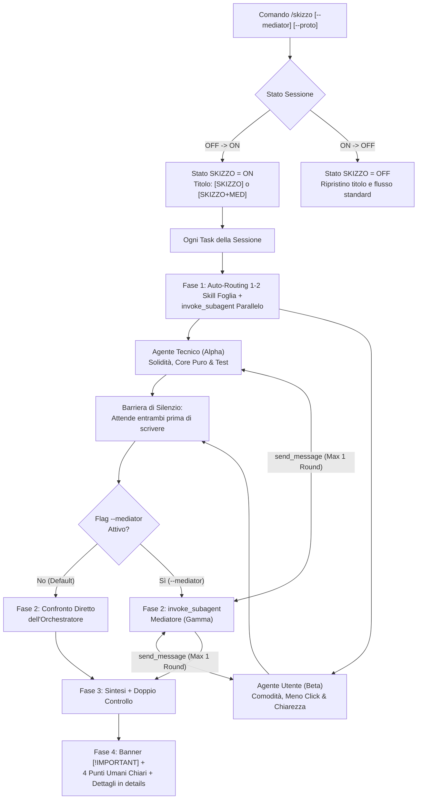

# Antigravity Plugin: Skizzo — Dual-Track Technical vs Domain Dialectics (`v1.3.0`)

Plugin di **Adversarial & Collaborative Dual-Track Engineering** per Google Antigravity. Mette in competizione e collaborazione parallela due subagent isolati con mandati complementari — **Agente Tecnico (`Subagent Alpha — Systems & Technical Purity`)** e **Agente Utente (`Subagent Beta — Domain & User Experience Advocate`)** — con auto-routing delle skill specialistiche, **Mediatore Interattivo** opzionale (`Subagent Gamma` tramite `/skizzo --mediator`) e restituzione finale **Human-First** in italiano semplice e priva di gergo da prompt engineer.

---

## Obiettivo del Plugin (Goal)

Quando un singolo agente sviluppa una funzionalità, tende inevitabilmente a un compromesso implicito fin dalle prime righe di ragionamento:
1. **Deriva Tecnocentrica**: un'architettura internamente elegante ma che espone complessità, configurazioni manuali o gergo implementativo all'utente finale.
2. **Deriva Superficiale (UI-First)**: un flusso utente apparentemente comodo ma costruito su accoppiamenti stato-DOM, validazioni fragili e assenza di isolamento headless.

Il plugin `skizzo` risolve questo limite strutturale tramite una **scissione controllata a 4 fasi** attivabile on-demand:
- **Dormiente di Default (`OFF`)**: non consuma risorse e non altera il comportamento dell'agente finché non viene attivato.
- **Toggle di Sessione (`/skizzo`)**: una volta attivato (`ON`), applica il protocollo Dual-Track a tutti i task successivi della conversazione (marcando il titolo chat con `[SKIZZO]` o `[SKIZZO+MED]`) finché non viene disattivato.
- **Biforcazione Cieca Parallela, Auto-Routing Skill & Silenzio Intermedio (`invoke_subagent`)**: seleziona automaticamente 1–2 skill verticali per ciascun binario (escludendo meta-skill come `skizzo`), delega in parallelo a `Alpha` e `Beta` e attende in silenzio che entrambi abbiano concluso prima di scrivere in chat.
- **Mediatore Interattivo Opzionale (`/skizzo --mediator` o `-m`)**: avvia nella Fase 2 un terzo subagent isolato (`Subagent Gamma`) che analizza i conflitti, contro-interroga `Alpha` e `Beta` tramite `send_message` (max 1 round) e pronuncia il verdetto arbitrale.
- **Restituzione Human-First (Zero Gergo Fuori da `<details>`)**: si apre con il banner `> [!IMPORTANT] MODALITÀ SKIZZO ATTIVA` con link `conversation://` e skill attivate, seguito da **4 punti in italiano quotidiano** (*Cosa cambia per te*, *Comodità difesa dall'Agente Utente*, *Problema evitato dall'Agente Tecnico*, *Su cosa non erano d'accordo e chi ha vinto*), confinando la tabella tecnica nel cassetto `<details>`.

---

## Componenti del Plugin

| Componente | Tipo | Percorso | Funzione |
| :--- | :--- | :--- | :--- |
| **Protocollo Dual-Track, Mediatore & Human-First** | Regola attiva | [`rules/AGENTS.md`](./rules/AGENTS.md) | Definisce la Clausola di Dormienza (`OFF`), il toggle `/skizzo`, l'auto-routing delle skill foglia, la barriera di silenzio sui wakeup parziali e il formato Human-First a 4 punti. |
| **`skizzo`** | Skill on-demand (`/skizzo`) | [`skills/skizzo/SKILL.md`](./skills/skizzo/SKILL.md) | Runbook autosufficiente con auto-routing delle skill, prompt per `Alpha`, `Beta` e `Gamma` e template di consegna Human-First. |
| **Template Dialettico** | Reference ausiliario | [`skills/skizzo/references/dialectic-template.md`](./skills/skizzo/references/dialectic-template.md) | Modelli per il banner `[!IMPORTANT]`, i 4 punti umani visibili, la matrice `<details>` e la modalità `/skizzo --proto`. |

---

## Architettura del Ciclo a 4 Fasi (`/skizzo` & `/skizzo --mediator`)



### Le 5 Regole Cardine del Protocollo

1. **Cecità Reciproca & Auto-Routing Skill Foglia in Fase 1**:
   L'Orchestratore assegna automaticamente 1–2 skill verticali a `Subagent Alpha` (tecniche) e `Subagent Beta` (dominio/UX), escludendo meta-skill come `skizzo`, e attende in silenzio che entrambi terminino prima di emettere testo in chat.
2. **Mediazione Interattiva in Fase 2 (`/skizzo --mediator`)**:
   Quando `--mediator` è attivo, `Subagent Gamma` contro-interroga `Alpha` e `Beta` tramite `send_message` (max 1 round) sui punti di disaccordo ed emette un verdetto motivato.
3. **Semplicità Fuori, Solidità Dentro in Fase 3**:
   Ogni comodità richiesta dall'`Agente Utente (Beta)` viene mantenuta all'esterno e sostenuta dietro le quinte dal codice robusto progettato dall'`Agente Tecnico (Alpha)`.
4. **Doppio Controllo Automatico**:
   Nessun task in modalità `skizzo` è completo se il codice non supera sia i test tecnici (`Alpha`) sia i test di scenario d'uso (`Beta`).
5. **Comunicazione Human-First in Fase 4**:
   Fuori dal menu `<details>` è bandito il gergo da prompt engineer: l'utente legge subito **Cosa cambia per te**, **Comodità difesa dall'Agente Utente**, **Problema evitato dall'Agente Tecnico** e **Su cosa non erano d'accordo**.

---

## Comandi e Prompt di Esempio

- `/skizzo` — Attiva (o disattiva se già attivo) la modalità a doppio agente (`[SKIZZO]`) per tutti i task successivi della chat.
- `/skizzo --mediator` (o `/skizzo -m`) — Attiva la modalità con il terzo agente Mediatore interattivo (`Subagent Gamma`, titolo `[SKIZZO+MED]`).
- `/skizzo --no-mediator` — Disattiva il Mediatore mantenendo attiva la modalità a 2 agenti.
- `/skizzo on` / `/skizzo off` — Forza esplicitamente l'attivazione o il ritorno allo stato dormiente.
- `/skizzo --mediator progetta e implementa il filtro di ricerca multi-criterio` — Lancia `Alpha` e `Beta` in parallelo, fa risolvere i disaccordi da `Gamma` e implementa la soluzione unificata.
- `/skizzo --proto rifattorizza il motore di calcolo tariffe` — Genera 2 prototipi completi in Git Worktrees isolati (`skizzo/alpha-tech` e `skizzo/beta-domain`) per il confronto empirico.

---

## Modalità di Installazione

Per sincronizzare e abilitare il plugin nella configurazione globale di Antigravity (`~/.gemini/config/plugins/`):

```bash
npm run sync
```

Dopo la prima sincronizzazione, ricaricare la finestra dell'IDE (`Ctrl+Shift+P` -> `Developer: Reload Window`) per rendere disponibile il comando slash `/skizzo` nell'autocompletamento della chat.
