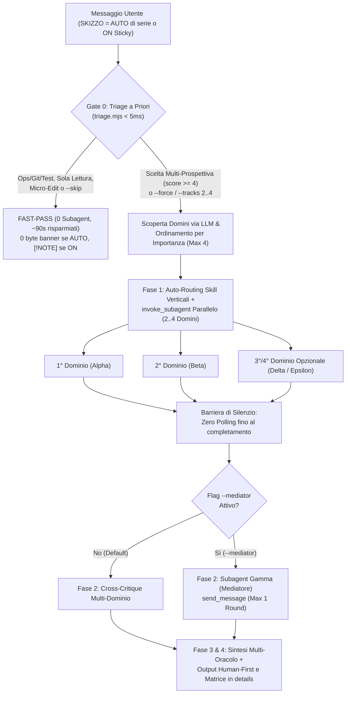

# Antigravity Plugin: Skizzo — Dynamic Multi-Domain Dialectics (`v1.7.0`)

Plugin di **Orchestrazione Competitiva e Collaborativa Multi-Dominio Dinamica** per Google Antigravity. Mette in competizione e collaborazione parallela **da `2` a `4` subagent isolati su misura** (`Alpha`, `Beta`, `Delta`, `Epsilon`) individuando semanticamente tramite LLM i domini coinvolti nella richiesta e ordinandoli per importanza — con **Modalità `Auto-Skizzo Silente` (`AUTO`) di serie**, **Filtro Automatico a Priori (`FAST-PASS` vs `MULTI-TRACK` in `< 5ms`)**, auto-routing delle skill verticali, **Mediatore Interattivo** opzionale (`Subagent Gamma` tramite `/skizzo --mediator`) e restituzione **Human-First**.

---

## Obiettivo del Plugin (Goal)

Quando un singolo agente affronta un problema complesso o multi-disciplinare, tende a schiacciare prospettive diverse in un compromesso implicito fin dalle prime righe. Al tempo stesso, usare sempre e solo 2 ruoli fissi risulta limitante quando la richiesta coinvolge più domini distinti o non riguarda affatto la programmazione.

Il plugin `skizzo` (`v1.7.0`) risolve entrambi i problemi tramite un **Gate 0 (`triage.mjs`) + Scoperta e Ranking dei Domini via LLM (`2..4` Agenti)**:
- **Attivo in Silenzio a Inizio Chat (`SKIZZO = AUTO`, Zero Banner sui Turni Diretti)**: sui task semplici o di sola lettura risponde subito in `FAST-PASS` con `0` subagent e `0 byte` di banner; sui bivi progettuali o multi-prospettiva (`score >= 4`) avvia in automatico i subagent necessari.
- **Scoperta Semantica e Ordinamento per Importanza (`Max 4` Agenti)**: superato il `FAST-PASS`, l'LLM individua tutti i domini o punti di vista rilevanti, li ordina per importanza decrescente (*Impatto diretto*, *Tensione dialettica*, *Rischio di omissione*) e istanzia solo i **primi `2..4` domini** (`DUAL-TRACK`, `TRI-TRACK` o `QUAD-TRACK`), accorpando o escludendo quelli marginali.
- **Persistenza Sticky (`/skizzo`) e Override**: attivato esplicitamente con `/skizzo`, abbassa la soglia (`score >= 3`) e mostra la ricevuta `[!NOTE]` sui `FAST-PASS`. L'utente può forzare gli agenti con `--force` o `--tracks 2|3|4`, saltarli con `--skip` o spegnere tutto con `/skizzo stop`.
- **Mediatore Interattivo Opzionale (`/skizzo --mediator` o `-m`)**: avvia nella Fase 2 `Subagent Gamma` che contro-interroga i domini attivi tramite `send_message` (max 1 round) ed emette il lodo arbitrale.
- **Restituzione Human-First (Zero Gergo Fuori da `<details>`)**: espone in chiaro cosa cambia per l'utente, il contributo dei domini attivati in ordine di importanza e il conflitto risolto, racchiudendo la matrice multi-dominio in `<details>`.

---

## Componenti del Plugin

| Componente | Tipo | Percorso | Funzione |
| :--- | :--- | :--- | :--- |
| **Protocollo Multi-Dominio Dinamico & Ranking LLM** | Regola attiva | [`rules/AGENTS.md`](./rules/AGENTS.md) | Definisce `SKIZZO = AUTO`, il Gate 0, l'ordinamento dei domini per importanza (`max 4`), gli override e il formato Human-First. |
| **`skizzo`** | Skill on-demand (`/skizzo`) | [`skills/skizzo/SKILL.md`](./skills/skizzo/SKILL.md) | Runbook autosufficiente con protocollo di scoperta/ranking LLM dei domini, prompt parametrico per `2..4` subagent e template di consegna. |
| **Motore Headless di Auto-Triage & Ranking (`O(1)`)** | Script Node.js | [`scripts/triage.mjs`](./scripts/triage.mjs) | Classificatore deterministico (`< 5ms`) `classifySkizzoTask` e funzione pura `rankAndCapDomains` per l'ordinamento e il taglio a `max 4` domini. |
| **Suite di Test Unitari Headless** | Test (`node:test`) | [`tests/triage.test.mjs`](./tests/triage.test.mjs) | Verifica il filtro `FAST-PASS` vs `MULTI-TRACK`, la tenuta su bivi non-software e il ranking/deduplica di `rankAndCapDomains`. |
| **Template Multi-Dominio** | Reference ausiliario | [`skills/skizzo/references/dialectic-template.md`](./skills/skizzo/references/dialectic-template.md) | Modelli per il banner `[!NOTE] FAST-PASS`, il banner `[!IMPORTANT]` a `2..4` domini e la matrice `<details>`. |

---

## Architettura del Gate 0 + Ranking LLM dei Domini (`/skizzo`)



---

## Comandi e Prompt di Esempio

- `/skizzo` — Attiva la modalità persistente esplicita (`[SKIZZO]`): individua e ordina i domini (`2..4` agenti) sulle scelte di progetto e risponde subito in `FAST-PASS` sulle modifiche dirette.
- `/skizzo --tracks 3 <task>` (o `--tracks 4`, `--force`) — Forza l'avvio di `N` subagent corrispondenti ai `N` domini più importanti.
- `/skizzo --skip <task>` (oppure *"senza skizzo"*) — Esegue il messaggio corrente in `FAST-PASS` (`0` subagent).
- `/skizzo stop` / `/skizzo off` / `stop skizzo` — Disattiva Skizzo per l'intera sessione e rimuove `[SKIZZO]` dal titolo.
- `/skizzo --mediator` (o `/skizzo -m`) — Attiva il Mediatore interattivo (`Subagent Gamma`, titolo `[SKIZZO+MED]`).

---

## Modalità di Verifica e Installazione

```bash
node --test plugins/skizzo/tests/triage.test.mjs
node scripts/validate.mjs --all
npm run sync
```
