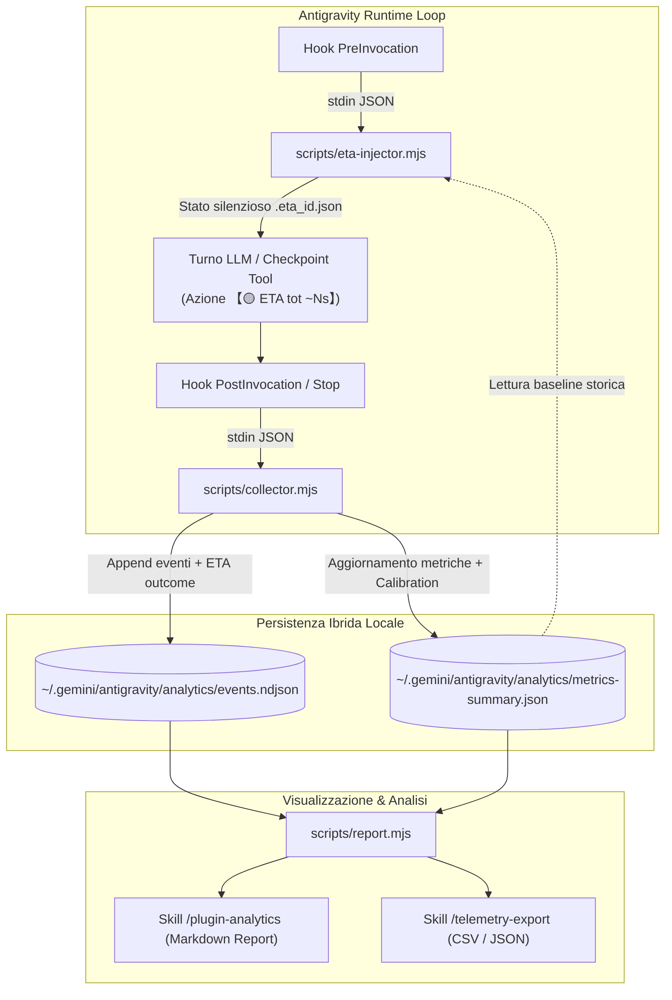

# Telemetry, Usage Analytics & Live ETA (`telemetry-analytics`)

Plugin di osservabilità, telemetria e stima in-flight dei tempi di completamento (ETA) sull'intera lavorazione per Google Antigravity. Raccoglie in modo deterministico e a basso overhead metriche sull'utilizzo dei plugin, traccia lo stato temporale senza inquinare i box di output dei tool e auto-calibra le stime confrontando il tempo previsto con la durata attiva effettiva.

---

## 1. Obiettivo Primario

Nel runtime di Antigravity, i plugin modulari operano come componenti integrati senza un layer nativo di reporting quantitativo. Il plugin `telemetry-analytics` introduce un'infrastruttura completa:
- **Stima ETA Ad Alto Contrasto con Badge + Semaforo (`【🟢/🟡/🔴 ETA tot ~Ns】`)**: Entro e non oltre il 2° turno di chiamate tool (per lavorazioni $\ge 15\text{s}$), e al passaggio al primo tool operativo top-level (`replace_file_content`, `write_to_file`, `run_command`), l'agente inserisce `【🟢/🟡/🔴 ETA tot ~Ns】` (`🟢` $\le 20\text{s}$, `🟡` $21\text{–}60\text{s}$, `🔴` $> 60\text{s}$) sia in `toolAction` sia in `toolSummary` di un singolo tool di svolta, garantendo risalto visivo e cromatico nel testo puro fuori dai gruppi collassati (`Explored N files >`).
- **Zero Log Invasivi nei Tool (`eta-injector.mjs`)**: L'hook `PreInvocation` aggiorna silenziosamente lo stato temporale (`.eta_<conversationId>.json`, al netto delle pause `ask_question`) restituendo `{}` su `stdout` per non iniettare mai testo nei box dei tool.
- **Auto-Calibrazione dell'Errore di Stima**: Alla chiusura del task (`Stop`), `collector.mjs` confronta l'ETA iniziale dichiarata con il tempo attivo effettivo (anche quando `PostInvocation` ha già avanzato `lastIndex`) e aggiorna la media mobile esponenziale `etaCalibrationFactor` del workspace.
- **Riconoscimento di Plugin, Skill e Affidabilità Tool**: Identifica le skill attivate, misura le latenze e traccia invocazioni, errori e cache-read ratio ad ogni turno.

---

## 2. Architettura Ibrida a Basso Overhead



### Caratteristiche Architetturali
1. **Badge + Semaforo (`【🟢/🟡/🔴 ETA tot ~Ns】`)**: Poiché `toolAction` e `toolSummary` sono renderizzati da Antigravity come nodi di testo puro (`textContent`) privi di supporto CSS/HTML, le parentesi lenticolari piene `【...】` abbinate al semaforo semantico di durata (`🟢` $\le 20\text{s}$, `🟡` $21\text{–}60\text{s}$, `🔴` $> 60\text{s}$) introducono uno stacco geometrico e un punto colore immediatamente visibili.
2. **Soglia Massima 2° Turno e Ancoraggio Top-Level**: L'ETA dell'intera lavorazione viene emessa entro il 2° turno di tool e ancorata sul primo tool operativo (`replace_file_content`, `write_to_file`, `run_command`) affinché resti sempre visibile in primo piano nella chat.
3. **Accoppiamento `toolAction` + `toolSummary` sui Soli Checkpoint**: Poiché Antigravity sostituisce `toolAction` con `toolSummary` dopo `< 1s`, il badge `【🟢/🟡/🔴 ETA tot ~Ns】` viene applicato a entrambi i campi del singolo tool di svolta, mantenendo puliti tutti gli altri tool finché la stima non varia di $\ge 15\text{s}$ o $\ge 30\%$.
4. **Esclusione Pause Utente e Messaggi in Coda**: I tempi di attesa su `ask_question` vengono sottratti dall'`Elapsed` e i messaggi utente accodati in corsa non azzerano la stima attiva.
5. **Resilienza e Timeout**: Tutti gli script integrano watchdog rigidi di sicurezza (`WATCHDOG_TIMEOUT_MS`) con `.unref()`.

---

## 3. Struttura del Plugin

```text
plugins/telemetry-analytics/
├── plugin.json                    # Manifest del plugin (SemVer 1.5.0, 3 prompt)
├── README.md                      # Documentazione tecnica
├── hooks.json                     # Hook PreInvocation, PostInvocation e Stop
├── scripts/
│   ├── eta-injector.mjs           # Tracciatore silenzioso dello stato ETA su PreInvocation
│   ├── collector.mjs              # Ingestore delta da transcript.jsonl e finalizzazione calibrazione ETA
│   └── report.mjs                 # Motore di aggregazione e reporting CLI
├── rules/
│   └── AGENTS.md                  # Regole di visibilità ETA Badge+Semaforo, soglia 2° turno e anti-razionalizzazione
└── skills/
    ├── plugin-analytics/
    │   └── SKILL.md               # Skill per consultare metriche e calibrazione ETA (/plugin-analytics)
    └── telemetry-export/
        └── SKILL.md               # Skill per esportare dati grezzi CSV/JSON (/telemetry-export)
```

---

## 4. Formato dell'Output ETA Durante le Lavorazioni

Per ogni lavorazione con durata residua $\ge 15\text{s}$, l'agente inserisce `【🟢/🟡/🔴 ETA tot ~Ns】` in `toolAction` e `toolSummary` del singolo tool di checkpoint (entro il 2° turno e sul primo tool operativo top-level):

- `Read plugin-analytics SKILL.md 【🟡 ETA tot ~30s】` (2° turno esplorativo, ultimo tool del batch — fascia media)
- `Upgrade telemetry-analytics to v1.5.0 【🟢 ETA tot ~15s】` (primo tool operativo top-level — fascia breve)
- `Run full integration suite 【🔴 ETA tot ~75s】` (comando pesante — fascia lunga)

Tutti gli altri tool intermedi restano privi di tag temporali e non viene stampata alcuna riga `[ETA: ...]` nel corpo testuale della chat.

---

## 5. Comandi CLI Diretti

```bash
# Report del workspace corrente (include tabella Stime ETA & Calibrazione)
node plugins/telemetry-analytics/scripts/report.mjs

# Report globale aggregato
node plugins/telemetry-analytics/scripts/report.mjs --global

# Output JSON per automazioni
node plugins/telemetry-analytics/scripts/report.mjs --json

# Esportazione CSV (include colonne EtaEstimatedMs, EtaActualMs)
node plugins/telemetry-analytics/scripts/report.mjs --csv > export.csv

# Reset dei dati
node plugins/telemetry-analytics/scripts/report.mjs --reset
```
