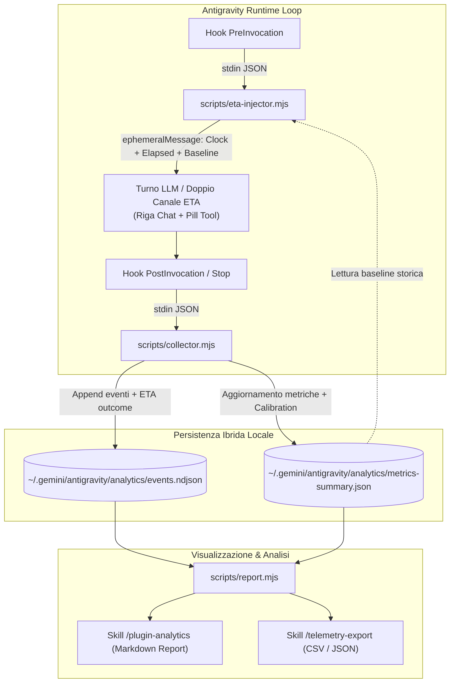

# Telemetry, Usage Analytics & Live ETA (`telemetry-analytics`)

Plugin di osservabilità, telemetria e stima in-flight dei tempi di completamento (ETA) per Google Antigravity. Raccoglie in modo deterministico e a basso overhead metriche sull'utilizzo dei plugin, inietta l'orologio real-time nei turni dell'agente per emettere stime ETA su doppio canale (chat + pill dei tool) e auto-calibra le stime confrontando il tempo previsto con la durata effettiva.

---

## 1. Obiettivo Primario

Nel runtime di Antigravity, i plugin modulari operano come componenti integrati senza un layer nativo di reporting quantitativo né un orologio visibile all'LLM durante i sub-turni intermedi. Il plugin `telemetry-analytics` introduce un'infrastruttura completa:
- **Stima ETA In-Flight su Doppio Canale**: Tramite l'hook `PreInvocation` (`scripts/eta-injector.mjs`), inietta nel contesto del modello l'ora corrente esatta, il tempo trascorso (`Elapsed`) dal prompt utente e la baseline storica. Per le lavorazioni multi-step ($\ge 2$ step/tool), l'agente stampa la riga di stato ETA in chat ad ogni cambio fase e inserisce `[Fase/Tot · ETA ~Ns]` direttamente nei badge `toolAction`/`toolSummary` dei tool. Le risposte corte single-step (`< 10s`) vengono silenziate per azzerare il rumore visivo.
- **Auto-Calibrazione dell'Errore di Stima**: Alla chiusura del task (`Stop`), `collector.mjs` confronta l'ETA iniziale dichiarata con il tempo effettivo e aggiorna la media mobile esponenziale `etaCalibrationFactor` del workspace.
- **Calcolo dei Tempi di Esecuzione**: Misura la latenza effettiva wall-clock di ciascun turno, sessione e singolo step.
- **Riconoscimento di Plugin e Skill**: Identifica le skill attivate tramite pattern matching deterministico sui file `SKILL.md` letti dall'agente.
- **Affidabilità dei Tool ed Economia dei Token**: Traccia invocazioni, errori, success rate e cache-read ratio ad ogni turno.

---

## 2. Architettura Ibrida a Basso Overhead



### Caratteristiche Architetturali
1. **Orologio Deterministico nei Sub-Turni (`PreInvocation`)**: L'LLM non tira mai a indovinare l'ora o il tempo trascorso; `eta-injector.mjs` legge il timestamp `created_at` dell'ultimo `USER_INPUT` da `transcript.jsonl` e calcola `Elapsed` al secondo.
2. **Fast-Path Silence**: Nessun banner ETA inutile sulle risposte dirette o single-step (`< 10s`).
3. **Resilienza e Timeout**: Tutti gli script integrano watchdog rigidi di sicurezza (`WATCHDOG_TIMEOUT_MS`) con `.unref()` per garantire che il loop dell'agente non resti mai bloccato.

---

## 3. Struttura del Plugin

```text
plugins/telemetry-analytics/
├── plugin.json                    # Manifest del plugin (SemVer 1.1.0, 3 prompt)
├── README.md                      # Documentazione tecnica
├── hooks.json                     # Hook PreInvocation, PostInvocation e Stop
├── scripts/
│   ├── eta-injector.mjs           # Iniettore real-time dell'orologio ETA e baseline su PreInvocation
│   ├── collector.mjs              # Ingestore batch da transcript.jsonl e calcolo calibrazione ETA
│   └── report.mjs                 # Motore di aggregazione e reporting CLI
├── rules/
│   └── AGENTS.md                  # Regole di emissione ETA su doppio canale, fast-path silence e sobrietà
└── skills/
    ├── plugin-analytics/
    │   └── SKILL.md               # Skill per consultare metriche e calibrazione ETA (/plugin-analytics)
    └── telemetry-export/
        └── SKILL.md               # Skill per esportare dati grezzi CSV/JSON (/telemetry-export)
```

---

## 4. Formato dell'Output ETA Durante le Lavorazioni

Per ogni task multi-step ($\ge 2$ step operativi), l'agente emette:

1. **Riga di Stato in Chat (Avvio e Cambio Fase)**:
   - All'avvio:
     `[ETA: ~45s (Fine stimata: 20:15:10) | Elapsed: 0s | Fase 1/3: Analisi file]`
   - Nei turni intermedi:
     `[ETA residuo: ~20s (Fine stimata: 20:15:08) | Elapsed: 23s | Fase 2/3: Modifica e test]`
   - Alla consegna finale:
     `[Completato in 39s | ETA iniziale: ~45s | Scostamento: -6s (-13.3%)]`

2. **Prefisso nelle Pill dei Tool (`toolAction` e `toolSummary`)**:
   - `[1/3 · ETA ~40s] Reading collector script`
   - `[2/3 · ETA ~20s] Updating telemetry rules`

---

## 5. Comandi CLI Diretti

```bash
# Report del workspace corrente (include tabella Stime ETA & Calibrazione)
node plugins/telemetry-analytics/scripts/report.mjs

# Report globale aggregato
node plugins/telemetry-analytics/scripts/report.mjs --global

# Output JSON per automazioni
node plugins/telemetry-analytics/scripts/report.mjs --json

# Esportazione CSV (include colonne EtaEstimatedMs, EtaActualMs)
node plugins/telemetry-analytics/scripts/report.mjs --csv > export.csv

# Reset dei dati
node plugins/telemetry-analytics/scripts/report.mjs --reset
```
