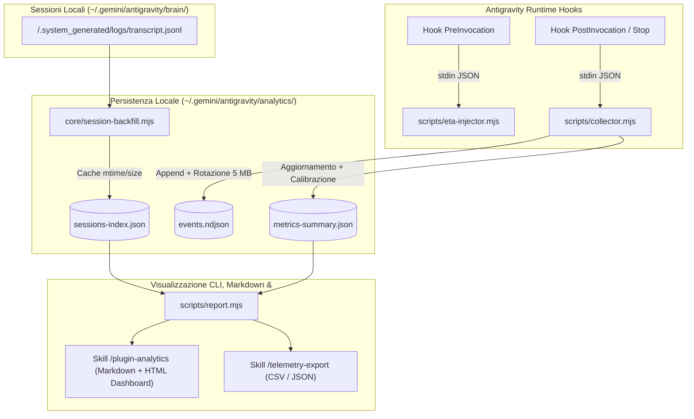

# Telemetry, Usage Analytics & Local Session Backfill (`telemetry-analytics` v2.0.0)

Plugin di osservabilità, monitoraggio dell'utilizzo personale e stima in-flight dei tempi di completamento (ETA) per Google Antigravity. Unisce la raccolta live tramite hook con un motore di **mining e backfill incrementale delle sessioni locali** (`~/.gemini/antigravity/brain/<id>/.system_generated/logs/transcript.jsonl`), estraendo abitudini orarie, tempo di lavoro attivo netto, consumo token/cache, modelli AI, comandi slash, plugin/skill e generando una Dashboard HTML interattiva (`<agent-embed>`).

---

## 1. Funzionalità Principali

1. **Backfill Incrementale dalle Sessioni Locali (`core/session-backfill.mjs`)**:
   - Scansiona tutte le conversazioni presenti in `~/.gemini/antigravity/brain/` e mantiene un indice incrementale (`~/.gemini/antigravity/analytics/sessions-index.json`) basato su `mtimeMs` e `size` per rianalizzare solo i transcript nuovi o modificati (`< 100ms` a regime).
   - Distingue automaticamente le **conversazioni umane** dai **subagent** (`invoke_subagent`).
   - Calcola il **tempo attivo netto** sommando gli intervalli tra step consecutivi ed escludendo le pause inattive `> 15 minuti`.
   - Ricostruisce la **distribuzione oraria (`00:00–23:00`)** e per **giorno della settimana**, i **modelli AI selezionati** (`<USER_SETTINGS_CHANGE>`), i **comandi slash** (`/plan`, `/skizzo`, `/next-step`, `/memory-sync`, ecc.), la ripartizione per **workspace/progetto** e le skill invocate (supportando sia `read_file` sia `view_file`).
2. **Dashboard HTML Interattiva (`references/usage-dashboard-template.html`)**:
   - Genera un widget HTML self-contained incorporabile via `<agent-embed>` con filtri istantanei per **Periodo** (`7g`, `30g`, `Storico`) e **Progetto**, 4 KPI Hero Card e 4 viste a tab (`Tempi & Abitudini`, `Token & Modelli`, `Workflow & Plugin`, `Storico Sessioni`).
3. **Stima ETA Complessiva con Badge + Semaforo (`【🟢/🟡/🔴 ETA tot ~Ns】`)**:
   - Entro il 2° turno di chiamate tool (per lavorazioni `>= 15s`), l'agente ancora `【🟢/🟡/🔴 ETA tot ~Ns】` in `toolSummary` di un singolo tool operativo visibile, e `collector.mjs` auto-calibra il fattore `etaCalibrationFactor`.

---

## 2. Architettura (`v2.0.0`)



---

## 3. Struttura del Plugin

```text
plugins/telemetry-analytics/
├── plugin.json                              # Manifest del plugin (SemVer 2.0.0)
├── README.md                                # Documentazione tecnica
├── hooks.json                               # Hook PreInvocation, PostInvocation e Stop
├── core/
│   └── session-backfill.mjs                 # Motore headless di parsing transcript.jsonl e indice incrementale
├── references/
│   └── usage-dashboard-template.html        # Template Dashboard HTML interattiva (<agent-embed>)
├── scripts/
│   ├── eta-injector.mjs                     # Tracciatore silenzioso dello stato ETA su PreInvocation
│   ├── collector.mjs                        # Ingestore delta live (read_file + view_file, totalSessions, ETA)
│   └── report.mjs                           # Motore di reporting CLI/Markdown e generatore Dashboard HTML
├── rules/
│   └── AGENTS.md                            # Regole di visibilità ETA e sobrietà metrica
├── skills/
│   ├── plugin-analytics/
│   │   └── SKILL.md                         # Skill per monitoraggio utilizzo e dashboard (/plugin-analytics)
│   └── telemetry-export/
│       └── SKILL.md                         # Skill per esportare dati grezzi CSV/JSON (/telemetry-export)
└── tests/
    └── session-backfill.test.mjs            # Test unitari sul motore di backfill e aggregazione
```

---

## 4. Comandi CLI Diretti

```bash
# Report globale completo (esegue il backfill incrementale da ~/.gemini/antigravity/brain/)
node plugins/telemetry-analytics/scripts/report.mjs --global

# Report globale filtrato sugli ultimi 7 giorni
node plugins/telemetry-analytics/scripts/report.mjs --global --days 7

# Genera anche la Dashboard HTML interattiva
node plugins/telemetry-analytics/scripts/report.mjs --global --html ./usage-dashboard.html

# Forza la ricostruzione integrale dell'indice delle sessioni
node plugins/telemetry-analytics/scripts/report.mjs --global --rebuild

# Esportazione JSON o CSV
node plugins/telemetry-analytics/scripts/report.mjs --global --json
node plugins/telemetry-analytics/scripts/report.mjs --csv > export.csv
```
